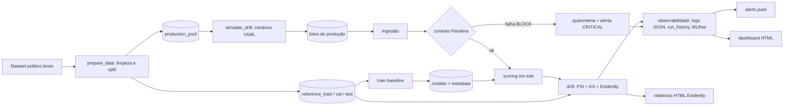

# Plano de Execução — Tech Challenge Fase 4 (MLET)
**Observabilidade Contínua, Detecção de Drift, Qualidade de Dados e Governança em Produção**

> Prazo informado: **15/11/2026 (domingo)** · Equipe: **4 pessoas** · Hoje: **20/10/2026** · Janela útil: **27 dias (~3,9 semanas)**
> Meta interna de entrega: **sábado 14/11**. O domingo 15/11 é **contingência**, sem trabalho planejado.
> Fonte principal: PDF `MLET - Tech Challenge - Fase 4`. O que **não** está no PDF é marcado como *recomendação do plano*.

---

## 1. Resumo executivo

**O que vamos construir:** o repositório `credit-scoring-observability`, uma camada de sustentação para um modelo de Credit Scoring. O fluxo é: **lote de dados → contrato Pandera (bloqueia lixo) → scoring → detecção de drift (PSI + KS + Evidently) → logs JSON + MLflow + alertas → relatórios/dashboard HTML**. Tudo roda com `make demo`.

**Decisões-chave (detalhadas adiante):**

| Decisão | Escolha | Por quê | 
|---|---|---|
| Dataset | **Give Me Some Credit** (Kaggle), com **UCI Default of Credit Card Clients** como plano B | **German Credit tem só 1.000 linhas e não atende ao mínimo de 5.000 do enunciado.** Give Me Some Credit tem idade e renda, que são as regras de exemplo do PDF. Confirmar licença e contagem em E0-02. |
| Modelo | scikit-learn `HistGradientBoostingClassifier` em `Pipeline` | Aceita NaN, sem instalação extra, rápido, reprodutível. |
| Contrato de dados | **Pandera** | Python puro, integra com pytest e devolve `failure_cases`. Menos peso que Great Expectations. |
| Drift | **Evidently** + PSI/KS próprios | Evidently é exigido; PSI/KS próprios dão controle e testabilidade. |
| Observabilidade | **MLflow local (SQLite)** + logs JSON + `run_history.jsonl` + `alerts.jsonl` + dashboard HTML estático | Cumpre "MLflow **ou** dashboard" com folga. Sem Prometheus, Datadog ou Airflow. |
| Orquestração | CLI Python + Makefile | Suficiente para o escopo e fácil de demonstrar. |

**Esforço:** backlog total **164 h**. Desse total, **P0 = 142,5 h**, P1 = 19,5 h e P2 = 2 h. A capacidade é de **~185 h** com 12 h/semana por pessoa e **~154 h** com 10 h/semana. Se a equipe tiver 10 h/semana, aplicar o **plano de corte** da seção 16.

**Marcos:**

| Marco | Data | Critério |
|---|---|---|
| M0 | Dom 25/10 | Contratos de integração v1 congelados (`docs/contracts.md` + `interfaces.py`) |
| M1 | Dom 01/11 | Etapa 1 completa: baseline treinado e contrato bloqueando lote inválido |
| M2 | Dom 08/11 | **MVP ponta a ponta** (`make demo` roda os 4 cenários) |
| M3 | Qua 11/11 23:59 | **Code freeze**: README completo. Depois só correção de bug |
| M4 | Sex 13/11 | Vídeo gravado e link no README |
| M5 | **Sáb 14/11** | **Entrega** |

---

## 2. Requisitos obrigatórios e critérios de avaliação

### 2.1 Requisitos extraídos do PDF

| ID | Requisito (fonte no PDF) | Onde é atendido |
|---|---|---|
| REQ-01 | Repositório GitHub com pipeline de validação de dados (data contracts) | E1-04 a E1-08 |
| REQ-02 | Scripts de simulação e detecção estatística de drift | E2-01 a E2-05b |
| REQ-03 | Dashboards ou relatórios HTML comprovando o monitoramento | E2-06, E2-14 |
| REQ-04 | Governança consolidada no `README.md` | E4-01 a E4-04, X-03 |
| REQ-05 | Histórico de commits semântico e organizado | Seção 11 |
| REQ-06 | Vídeo ≤ 5 min, método STAR | V-01 a V-03 |
| REQ-07 | Scikit-Learn/XGBoost para o modelo base | E1-03 |
| REQ-08 | Great Expectations **ou** Pandera | E1-04 |
| REQ-09 | Evidently AI (ou Alibi Detect) | E2-05b |
| REQ-10 | Separação Referência × Análise/Produção | E1-02 |
| REQ-11 | ≥ 3 regras rígidas de qualidade | E1-04 |
| REQ-12 | Relatório estatístico da mudança de distribuição (PSI ou KS) | E2-05a, E2-06 |
| REQ-13 | Plano de privacidade (LGPD) | E4-01 a E4-03 |
| REQ-14 | Lote com erros forçado, contrato falha e **bloqueia a ingestão** | E1-05 a E1-08 |
| REQ-15 | Dataset de produção com ≥ 2 variáveis alteradas + predições | E2-02, E2-04 |
| REQ-16 | Centralizar logs de execução e resultados de drift | E1-09, E1-10, E2-11 |
| REQ-17 | MLflow **ou** dashboard interativo/estático | E2-11, E2-14 |
| REQ-18 | Documentar métricas de saúde (status, latência, volume, alertas) | E2-15 |
| REQ-19 | Base legal da decisão de crédito, plano de retenção, mitigação de vieses | E4-02, E4-03, E4-04 |
| REQ-20 | Documentação de **Causalidade** no README (entregável da Etapa 4) | E4-05, E4-06 |
| REQ-21 | Link do vídeo no README | V-03, X-03 |
| REQ-22 | Dataset financeiro binário com ≥ 5.000 amostras | E0-02 |

**Observações importantes:**
- O texto de contexto do PDF cita **Concept Drift**, mas as tarefas da Etapa 2 pedem **Data Drift**. Tratamos Concept Drift como **P1**: ele melhora a análise causal e a seção de limitações.
- O **Prometheus-client é opcional**, e só faz sentido se a equipe integrar com a Fase 3. **Não é requisito.**
- **Docker, CI, dashboard HTML customizado, ADRs e testes de calibração de thresholds são recomendações do plano.** Nenhum deles está no PDF.
- O PDF diz que o Tech Challenge vale **90% da nota de todas as disciplinas da fase**. Por isso a data e a qualidade da entrega são críticas.

### 2.2 Critérios de avaliação → evidência que a banca precisa ver

| Critério | Peso | A banca precisa ver | Evidência (arquivo ou comando) | Tarefas |
|---|---:|---|---|---|
| Validação de Dados | 25% | Contrato configurado interceptando anomalias | `make validate-invalid` com exit code 2 e JSON listando as regras violadas; lote em `data/quarantine/`; `pytest` verde | E1-04 a E1-08 |
| Detecção de Drift | 25% | Simulação correta + relatório claro do Evidently | HTML do Evidently mostrando ≥ 2 variáveis alteradas; tabela PSI/KS; cenário de controle sem drift | E2-01 a E2-08 |
| Observabilidade e Logs | 20% | Métricas de saúde e alertas, de forma visual | MLflow UI + dashboard HTML + `alerts.jsonl` + `docs/observability_metrics.md` | E1-09, E1-10, E2-10, E2-11, E2-14, E2-15 |
| Governança (LGPD) | 15% | Privacidade, base legal, mitigação de vieses | README §Governança, inventário de dados, `bias_report.md`, seção Causalidade | E4-01 a E4-06 |
| Vídeo STAR | 15% | Demonstração da degradação e do impacto, ≤ 5 min | Link no README | V-01 a V-04 |

**Como usamos os pesos:** Validação e Drift somam 50% e recebem o maior cuidado em testes. Observabilidade tem MLflow como P0 e o dashboard como P1. O vídeo (15%) tem tempo reservado e **gravação só depois do code freeze**.

---

## 3. Premissas e informações pendentes

### 3.1 O que falta confirmar (levar ao Discord ou ao professor)

| # | Pendência | Premissa usada | Se for diferente |
|---|---|---|---|
| 1 | Horário e portal de entrega (a data 15/11 foi informada; **o horário não**) | Entregar até sáb 14/11 | Ajustar M4 e M5 |
| 2 | Disponibilidade semanal de cada integrante | 12 h/semana por pessoa (faixa 10–12) | Com 10 h/semana, aplicar o plano de corte (seção 16) |
| 3 | Domínio da equipe em Evidently, Pandera e MLflow | Todos sabem Python e Git; **ninguém** domina as três bibliotecas, então há *spikes* na semana 0 | Se alguém já domina, reduzir E0-03 a E0-05 |
| 4 | Reuso da Fase 3 (API Docker, GitHub Actions, Prometheus/Grafana, Airflow) | Reaproveitar **somente o workflow do GitHub Actions e o padrão de Dockerfile**, se o repositório for do mesmo grupo | Se houver exporter Prometheus pronto, avaliar +2–3 h para expor as métricas (opcional) |
| 5 | Restrições de ambiente | Notebooks pessoais, Python 3.11, sem GPU, sem cloud, internet disponível | Se alguém não tiver conta Kaggle, usar o plano B (UCI, sem login) |
| 6 | O vídeo exige todos os integrantes? Qual formato e onde hospedar? | Narração por 1–2 pessoas; hospedagem em YouTube não listado ou Drive | Ajustar V-03 |
| 7 | Há regras sobre IA generativa ou revisão de autoria no projeto? | Não | Documentar o uso no README |

### 3.2 Reuso da Fase 3

| Item | Decisão |
|---|---|
| Workflow de CI (GitHub Actions) | **Reutilizar** a estrutura (lint + pytest) |
| Dockerfile | **Adaptar** (base `python:3.11-slim`) |
| Prometheus + Grafana | **Não carregar** por padrão. MLflow + HTML cobrem o PDF |
| Airflow e API REST | **Não carregar**: complexidade sem retorno para esta fase |

---

## 4. Arquitetura recomendada



**Fluxo completo:**
1. `prepare` limpa o dataset e gera 4 arquivos: `reference_train` (60%), `reference_val` (10%), `reference_test` (10%) e `production_pool` (20%). O pool **nunca** entra no treino.
2. `train` treina o baseline com `reference_train` e avalia em val/test. Salva modelo e metadata.
3. `simulate` pega amostras do pool e aplica transformações do `drift_scenarios.yaml`, gerando lotes ao longo de uma linha do tempo.
4. `pipeline.run` processa cada lote em 6 estágios: **ingest → validate → score → drift → observe → alerts**.
5. Se o contrato falha em regra **BLOCK**, o arquivo vai para quarentena, **nenhuma predição é gerada** e um alerta CRITICAL é emitido.
6. Cada execução grava logs JSON, uma linha em `run_history.jsonl` e um run no MLflow.
7. O dashboard HTML lê `run_history.jsonl` e `alerts.jsonl`.

**Cenários de dados (cada um é uma sequência de lotes):**

| Cenário | Finalidade | Alteração |
|---|---|---|
| `no_drift` | Controle (deve **não** alertar) | Amostra do pool sem alteração |
| `covariate_moderate` | Data Drift em 2 variáveis | `monthly_income` ↑ (renda nominal inflada) e `revolving_utilization` ↑ |
| `covariate_severe` | Data Drift em 3 variáveis, intensidade progressiva | + `debt_ratio` ↑ |
| `concept_drift` (P1) | Mostrar limite de detectar sem rótulo | Covariáveis iguais ao pool, rótulos sintéticos com relação X→y alterada |
| `_invalid/*` | Provar o bloqueio do contrato | Cada lote com **uma** violação |

`age` e `dependents` ficam **sem alteração** como variáveis de controle. Elas servem para mostrar que o detector não sinaliza tudo.

**Data Drift × Concept Drift (para o README e o vídeo):**
- **Data Drift** muda P(X). Dá para detectar **sem rótulos**.
- **Concept Drift** muda P(y|X). Só se confirma com rótulos, que em crédito chegam com atraso (o resultado de inadimplência só aparece meses depois).
- **Mudança em P(X) não prova, por si só, que o desempenho piorou.** O cenário `concept_drift` mostra o inverso: a performance cai e o relatório de data drift quase não reage. O quadro "o que monitorar sem rótulo × com rótulo" vai para `docs/evidence/perf_vs_drift.md`.

---

## 5. Stack tecnológica

| Componente | Escolha | Justificativa | Observação |
|---|---|---|---|
| Linguagem | Python **3.11** | Compatível com todas as libs | Fixar no CI e no Docker |
| Dados | pandas + pyarrow (Parquet) | Tipos preservados, rápido | CSV só para os lotes de demonstração, se necessário |
| Modelo | scikit-learn `HistGradientBoostingClassifier` | Trata NaN, sem dependência extra | XGBoost só se a equipe preferir (PDF aceita ambos) |
| Contrato | **Pandera** (`lazy=True`) | Falhas por linha e por regra | Fixar versão e conferir o import na versão instalada |
| Drift | **Evidently** + `scipy` | Relatório HTML + estatística explícita | **A API do Evidently mudou muito entre versões.** Fixar a versão exata e basear o código na documentação dessa versão (spike E0-03) |
| Schemas dos JSON | `pydantic` v2 | Contrato de integração executável | Valida saídas na CI |
| Tracking | **MLflow** com SQLite local | Atende o PDF, UI pronta | `mlflow ui --backend-store-uri sqlite:///mlflow/mlflow.db` |
| Dashboard | Jinja2 + Plotly (HTML estático) | Abre offline | P1 |
| Testes e lint | pytest, ruff | Padrão | CI no GitHub Actions |
| Orquestração | CLI + Makefile | Simples | Sem Airflow |
| Container | Docker | Reprodutibilidade | **P2** |

**Alternativas relevantes:** Great Expectations seria a alternativa ao Pandera. Não é recomendado: mais configuração para o mesmo resultado. Alibi Detect é aceito pelo PDF, mas o relatório HTML do Evidently é mais direto para a banca.

---

## 6. Estrutura inicial do repositório

```text
credit-scoring-observability/
├── README.md                        # consolidado (seção 14)
├── Makefile                         # setup, data, train, simulate, demo, test, lint, bias, evidence
├── requirements.txt                 # versões fixas
├── requirements-dev.txt
├── Dockerfile                       # P2
├── .gitignore                       # data/, artifacts/, mlflow/, models/*.joblib (se grande)
├── .github/
│   ├── workflows/ci.yml             # ruff + pytest
│   └── PULL_REQUEST_TEMPLATE.md
├── config/
│   ├── data.yaml                    # colunas, id, target, seed, proporções de split
│   ├── contract.yaml                # limites das regras (idade, renda máxima, etc.)
│   ├── model.yaml                   # hiperparâmetros, threshold, AUC mínimo
│   ├── drift_scenarios.yaml
│   ├── drift_thresholds.yaml
│   └── alerts.yaml
├── data/                            # NÃO versionado (só .gitkeep + README de obtenção)
│   ├── README.md                    # como baixar, licença, checksum
│   ├── raw/  processed/  production/  quarantine/
├── models/
│   └── baseline_v1.json             # metadata (o .joblib só se for pequeno)
├── src/creditwatch/
│   ├── interfaces.py                # modelos pydantic + assinaturas (contrato v1)
│   ├── data/        download.py  prepare.py
│   ├── model/       train.py  predict.py  evaluate.py  fairness.py
│   ├── contracts/   schema.py  validate.py  ingestion.py
│   ├── simulation/  scenarios.py  generate.py
│   ├── drift/       stats.py  evidently_runner.py  detector.py  reports.py
│   ├── observability/ logging.py  metrics.py  alerts.py  mlflow_tracker.py  dashboard.py
│   └── pipeline/    run.py
├── scripts/                         # make_invalid_batches.py, causal_ablation.py
├── tests/  unit/  integration/  e2e/
├── artifacts/                       # gerado; NÃO versionado
│   ├── logs/  metrics/  alerts/  validation/  drift/  scored/  dashboard/
├── reports/                         # evidências selecionadas, versionadas (via `make evidence`)
├── docs/
│   ├── contracts.md                 # contratos de integração (seção 10)
│   ├── architecture.md  observability_metrics.md  thresholds.md
│   ├── decisions/ADR-001-dataset.md ...
│   ├── evidence/                    # prints, perf_vs_drift.md, bias_report.md, ablation.md
│   └── video/roteiro_star.md
└── notebooks/                       # só EDA (não faz parte do pipeline)
```

**Dados no GitHub:** não versionar o dataset. O `data/README.md` documenta origem, licença, SHA-256 e como baixar. Versionar apenas relatórios HTML selecionados (pequenos) em `reports/`.

---

## 7. Cronograma por semana e dia

**Legenda:** nas colunas de responsável, **P1 a P4 são as 4 pessoas** (não confundir com a prioridade P0/P1/P2 da coluna "Tipo · Pri"). P1 = Dados, Modelo e Integração · P2 = Contratos, Testes e Vídeo · P3 = Drift e Simulação · P4 = Observabilidade, Governança e Docs.
**Horas planejadas** incluem revisões de PR e reuniões.

### Sprint 0: Setup e contratos (Ter 20/10 a Dom 25/10)

| Dia | P1 | P2 | P3 | P4 | Marco |
|---|---|---|---|---|---|
| Ter 20 | E0-01 (repo) · **kickoff 45 min (todos)** | Ler PDF | Ler PDF | Ler PDF | Kickoff |
| Qua 21 | E0-01 fim · E0-02 | E0-04 | E0-03 | E0-05 | |
| Qui 22 | E0-02 (ADR-001) · E1-01 | E0-07 (CI) | rascunho `drift_scenarios.yaml` | rascunho de campos de log | Dataset decidido |
| Sex 23 | E0-06 (rascunho) | revisar rascunho | revisar rascunho | E4-01 | |
| Sáb 24 | **E0-06 workshop 90 min (todos)** | idem | idem | idem | |
| Dom 25 | PR de contratos | aprova | aprova | aprova | **M0: contratos v1** |

### Sprint 1: Etapa 1 completa + base da simulação (Seg 26/10 a Dom 01/11)

| Dia | P1 | P2 | P3 | P4 |
|---|---|---|---|---|
| Seg 26 | E1-02 | E1-04 (com dados sintéticos até P1 entregar) | E2-01 | E1-09 |
| Ter 27 | **E1-02 entrega splits até 20h** | E1-04 | E2-01 | **E1-09 entrega logging até 20h** |
| Qua 28 | E1-03 | E1-05 | E2-02 | E1-10 |
| Qui 29 | E1-03 (PR) | E1-06 | E2-02 | E4-02 |
| Sex 30 | E1-11 | E1-06 · E1-07 | E2-03 | E4-02 · E2-15 |
| Sáb 31 | E1-11 | E1-07 | E2-05a | E2-15 |
| Dom 01 | revisões de PR · **call 30 min** | | | **M1: demo manual da Etapa 1** |

### Sprint 2: Drift, observabilidade e MVP (Seg 02/11 a Dom 08/11)
*Seg 02/11 é feriado (Finados): dia opcional. Planejar sem depender dele.*

| Dia | P1 | P2 | P3 | P4 |
|---|---|---|---|---|
| Seg 02 | (opcional) | (opcional) E1-08 | (opcional) E2-05b | (opcional) E2-10 |
| Ter 03 | E2-04 | E1-08 | E2-05b | E2-10 |
| Qua 04 | E2-12 (ingest, validate, score) | E2-13 (esqueleto) | E2-05b | E2-11 · **smoke test do pipeline** |
| Qui 05 | E2-12 (drift, observe, alerts) | E2-13 | E2-06 | E2-11 · E2-14 (parte 1) |
| Sex 06 | E2-12 fim | E2-13 fim | E2-06 · E2-07a | E2-14 (parte 1) |
| Sáb 07 | E2-07b | E2-16 (Docker) | E2-08 | E4-03 |
| Dom 08 | | | | **M2: tag `v0.1-mvp` · call 45 min · lista de pendências** |

### Sprint 3: Fechamento, documentação e vídeo (Seg 09/11 a Dom 15/11)

| Dia | P1 | P2 | P3 | P4 |
|---|---|---|---|---|
| Seg 09 | E4-04 | corrigir bugs do M2 | E2-09 | E2-14 (parte 2) |
| Ter 10 | E4-04 | **X-02 teste em ambiente limpo** | E4-05 | E4-06 · **V-01 roteiro** |
| Qua 11 | X-01 (integração e fixes) · E1-12 | X-04 (revisão do README) | E4-05 fim | X-03 (README) · **M3: code freeze 23:59** |
| Qui 12 | V-02 (demo determinística) | **V-03 ensaio e take 1** | V-04 (ensaio) | revisão final do README |
| Sex 13 | suporte | **V-03 gravação final, edição e upload** | suporte | link do vídeo no README · **M4** |
| Sáb 14 | checklist final (seção 15) | checklist | checklist | **M5: entrega** |
| Dom 15 | contingência | contingência | contingência | contingência |

### Horas planejadas × capacidade

| Sprint | P1 | P2 | P3 | P4 | Total | Capacidade (12 h/sem) |
|---|---:|---:|---:|---:|---:|---:|
| S0 | 8 | 5 | 4 | 5,5 | 22,5 | ~41 (6 dias) |
| S1 | 11 | 13,5 | 11,5 | 10,5 | 46,5 | 48 |
| S2 | 11,5 | 9,5 | 14,5 | 12,5 | 48 | 48 (feriado reduz) |
| S3 | 13,5 | 10 | 8,5 | 15 | 47 | 48 |
| **Total** | **44** | **38** | **38,5** | **43,5** | **164** | **~185** |

S0 tem folga: usar para ler a documentação das bibliotecas. **S1 e S2 são os picos.**

---

## 8. Backlog priorizado

**Como ler:** em `Resp`, P1 a P4 são as pessoas; em `Pri`, P0/P1/P2 são prioridades. `Tipo` = DEV (desenvolvimento), PESQ (pesquisa técnica), INT (integração), TEST (teste), DOC (documentação), VID (vídeo). `Pri` = P0 (indispensável), P1 (qualidade), P2 (opcional). `Sp` = sprint. Cada tarefa tem **aceite verificável**, com o teste que comprova. Dependências de integração aparecem em "Dep." e na seção 10.

### 8.1 Setup (Sprint 0)

| ID | Tipo · Pri | Resp | Sp | Dep. | h | Tarefa e objetivo | Arquivos | Aceite verificável + teste | Risco |
|---|---|---|---|---|---:|---|---|---|---|
| E0-01 | INT · P0 | P1 | S0 | — | 2 | Criar repo, estrutura, `requirements*.txt` com versões fixas, Makefile (`setup`, `test`, `lint`, `demo`), `.gitignore`, template de PR, proteger `main` | raiz | Clone limpo + `make setup && make test` passa (1 teste dummy). `main` só aceita PR | Conflito de versões → fixar Python 3.11 |
| E0-02 | PESQ · P0 | P1 | S0 | — | 1,5 | Decidir dataset: confirmar ≥ 5.000 linhas, licença/termos, target binário, colunas de idade e renda | `docs/decisions/ADR-001-dataset.md` | ADR com nº de linhas medido (`len(df)`), % de positivos, link, termos de uso. Aprovado por todos no PR | Kaggle exige login e aceite de regras → plano B UCI |
| E0-03 | PESQ · P0 | P3 | S0 | E0-01 | 2,5 | Spike Evidently: gerar relatório de drift entre 2 DataFrames de brinquedo e **descobrir como extrair o resultado programaticamente** | `notebooks/spike_evidently.py`, ADR-002 | `reports/spike.html` abre; ADR-002 registra versão fixada e o trecho de código de extração | API muda entre versões |
| E0-04 | PESQ · P0 | P2 | S0 | E0-01 | 1,5 | Spike Pandera: schema de brinquedo com 3 regras, `lazy=True`, extrair `failure_cases` | `notebooks/spike_pandera.py`, ADR-003 | Script imprime falhas por regra e por linha. ADR-003 com versão e import corretos | Import varia por versão |
| E0-05 | PESQ · P0 | P4 | S0 | E0-01 | 1,5 | Spike MLflow local (SQLite) com 1 run (métrica + artefato HTML) | `notebooks/spike_mlflow.py`, ADR-004 | UI abre e mostra o run com artefato | Porta ocupada, caminhos no Windows |
| E0-06 | INT · P0 | Todos (P1 lidera) | S0 | E0-02 a E0-05 | 7 (P1 2,5; demais 1,5) | **Workshop de contratos:** `docs/contracts.md` v1, `interfaces.py` com modelos pydantic e assinaturas, YAMLs esqueleto, thresholds iniciais (convenção, a calibrar em E2-09) | `docs/contracts.md`, `src/creditwatch/interfaces.py`, `config/*.yaml` | PR aprovado pelos 4. `python -c "import creditwatch.interfaces"` funciona. `make test` verde. Tag `contracts-v1` | Desacordo → P1 decide em 24h (seção 9) |
| E0-07 | INT · P1 | P2 | S0 | E0-01 | 2 | CI no GitHub Actions: ruff + pytest. Reaproveitar o workflow da Fase 3, se existir | `.github/workflows/ci.yml` | PR com teste quebrado fica **vermelho**; PR correto fica verde | — |


### 8.2 Etapa 1: Validação de dados e baseline (Sprints 0 a 2)

| ID | Tipo · Pri | Resp | Sp | Dep. | h | Tarefa e objetivo | Arquivos | Aceite verificável + teste | Risco |
|---|---|---|---|---|---:|---|---|---|---|
| E1-01 | DEV · P0 | P1 | S0 | E0-02 | 2 | Obtenção do dataset (API Kaggle ou download manual documentado) e renomeação para snake_case conforme `config/data.yaml` | `data/download.py`, `data/README.md`, `config/data.yaml` | `make data` gera parquet com ≥ 5.000 linhas e colunas = contrato (`test_columns_match_config`). Instrução funciona em máquina limpa, com SHA-256 | Credencial Kaggle → permitir download manual |
| E1-02 | DEV · P0 | P1 | S1 | E1-01, E0-06 | 3 | Limpar e dividir: códigos especiais → NaN (ex.: valores 96/98 em colunas de contagem, se existirem), remover duplicatas, gerar `customer_id` pseudonimizado, tratar renda nula **conforme ADR** (remover da referência e do pool, registrando o %), split estratificado com seed: ref_train 60%, ref_val 10%, ref_test 10%, pool 20% | `data/prepare.py` | 4 parquets em `data/processed/`. Testes: soma = total; **sem interseção de `customer_id`** entre splits; proporção do target igual ±1 p.p.; reference passa no contrato (quando E1-04 existir). **Entrega a P2 e P3 até 27/10** | Vazamento entre pool e treino |
| E1-03 | DEV · P0 | P1 | S1 | E1-02 | 4 | Treinar baseline, escolher threshold documentado, avaliar em val/test: ROC-AUC, PR-AUC, KS, Brier, matriz de confusão. Salvar modelo e metadata | `model/train.py`, `model/evaluate.py`, `models/baseline_v1.*`, `config/model.yaml` | `make train` gera artefatos. Metadata tem versão, SHA do dataset, features, seed, métricas. Teste: AUC_test > `DummyClassifier` + margem em `config/model.yaml` (valor inicial sugerido: 0,75; **ajustar após ver o resultado real**). Mesma seed reproduz o AUC | Classe desbalanceada: não usar acurácia |
| E1-04 | DEV · P0 | P2 | S1 | E0-04, E0-06 | 4 | Contrato Pandera v1.0.0. **Regras BLOCK:** `R01_AGE_RANGE` (idade ≥ 18 e ≤ limite em config), `R02_INCOME` (não nulo, ≥ 0, ≤ teto em config), `R03_NO_DUPLICATES` (`customer_id` e linha inteira), `R04_SCHEMA` (colunas e tipos obrigatórios), `R05_NONNEG` (utilização, debt_ratio e contagens ≥ 0). **Regras WARN:** `W01_NULL_RATE`, `W02_MIN_VOLUME` | `contracts/schema.py`, `config/contract.yaml` | ≥ 3 regras BLOCK com `rule_id` estável. `reference_*.parquet` passam sem BLOCK | Versão do Pandera |
| E1-05 | DEV · P0 | P2 | S1 | E1-02 | 2 | Gerar lotes: `valid_control`, `invalid_age`, `invalid_income_null`, `invalid_duplicates`, `invalid_schema`, `invalid_mixed`. Cada um (exceto o misto) com **uma** violação | `scripts/make_invalid_batches.py`, `data/production/_invalid/MANIFEST.json` | O manifesto lista a regra esperada de cada lote; teste confere o manifesto | Lote com 2 violações confunde a demo |
| E1-06 | DEV · P0 | P2 | S1 | E1-04 | 3 | `validate_batch()` + CLI. Saída `ValidationResult` JSON, exit code 0 ou 2 | `contracts/validate.py` | CLI com `invalid_age` → exit 2 e JSON citando `R01`. Com `valid_control` → exit 0 | Falhas sem índice → `lazy=True` |
| E1-07 | TEST · P0 | P2 | S1 | E1-05, E1-06 | 3 | Testes parametrizados: cada lote inválido é bloqueado **pela regra esperada**; lote válido passa; reference passa; WARN não bloqueia | `tests/unit/test_contracts.py` | `pytest` verde na CI. Print do pytest vai para `docs/evidence/` | — |
| E1-08 | DEV · P0 | P2 | S2 | E1-06, E1-09 | 2 | `ingest_batch()`: valida; se BLOCKED, move para `data/quarantine/`, loga `validation_blocked` e levanta `BatchRejected` | `contracts/ingestion.py` | Teste: lote inválido → `BatchRejected`, arquivo em quarantine, **`score_batch` nunca chamado** (spy) | — |
| E1-09 | DEV · P0 | P4 | S1 | E0-06 | 3 | Logging JSON: `RunContext` (run_id), `get_logger`, decorator `@stage("...")` que registra início, fim, duração e status. **Entregar até 27/10: desbloqueia todos** | `observability/logging.py` | Teste: cada estágio gera 2 linhas JSON com os campos mínimos. Exceção gera `status=error` e é relançada | Interface precisa estar estável |
| E1-10 | DEV · P0 | P4 | S1 | E1-09 | 2 | `record_run(RunMetrics)`: grava linha em `artifacts/metrics/run_history.jsonl` (MLflow entra em E2-11) | `observability/metrics.py` | Teste: 3 chamadas → 3 linhas válidas pelo schema pydantic | — |
| E1-11 | INT · P0 | P1 | S1 | E0-06 | 3 | Esqueleto do pipeline com **stubs** das interfaces; exit codes 0 (ok), 2 (bloqueado), 3 (erro) | `pipeline/run.py` | `make demo-smoke` roda com stubs e gera log JSON de todos os estágios | Stubs divergem das interfaces |
| E1-12 | DOC · P1 | P1 | S3 | E2-12 | 2 | `docs/architecture.md` e diagrama Mermaid finais (esboço vai no PR de E0-06) | `docs/architecture.md` | Diagrama renderiza no GitHub e reflete as pastas reais | — |

### 8.3 Etapa 2: Simulação e drift (Sprints 1 a 3)

| ID | Tipo · Pri | Resp | Sp | Dep. | h | Tarefa e objetivo | Arquivos | Aceite verificável + teste | Risco |
|---|---|---|---|---|---:|---|---|---|---|
| E2-01 | DEV · P0 | P3 | S1 | E0-06 | 3 | Framework de simulação: ler `drift_scenarios.yaml`, operações `scale`, `shift_add`, `resample_mix`, com seed e clip. Usar pool sintético até P1 entregar | `simulation/scenarios.py`, `config/drift_scenarios.yaml` | Testes: mesma seed → mesmo resultado; `scale` ×k move a média em k (±tolerância); colunas não listadas permanecem **idênticas** | — |
| E2-02 | DEV · P0 | P3 | S1 | E1-02, E2-01 | 3 | Cenários `no_drift`, `covariate_moderate` (renda e utilização), `covariate_severe` (+ debt_ratio). `age` e `dependents` intocadas | yaml, `simulation/generate.py` | `make simulate` gera `data/production/<cenário>/batch_XX.parquet` + `MANIFEST.json` (features alteradas e parâmetros). **Todos passam no contrato** | Drift fraco demais → aumentar intensidade |
| E2-03 | DEV · P0 | P3 | S1 | E2-02 | 1,5 | Linha do tempo: N lotes por cenário, `event_date` crescente, intensidade progressiva (`ramp`) | `generate.py` | MANIFEST lista data e intensidade por lote. Teste: intensidade monotônica | — |
| E2-04 | DEV · P0 | P1 | S2 | E1-03 | 2 | `score_batch()`: adiciona `score`, `prediction`, `model_version`; salva em `artifacts/scored/` | `model/predict.py` | Teste: score ∈ [0,1]; mesmos ids e nº de linhas; determinístico; latência medida | — |
| E2-05a | DEV · P0 | P3 | S1 | E0-06 | 3 | `psi()` (bins por quantis da **referência**, epsilon para bins vazios) e wrapper de KS (`scipy`) | `drift/stats.py` | Testes: PSI(x,x) ≈ 0; PSI cresce com deslocamento conhecido; estatística KS = `scipy` | Bins vazios |
| E2-05b | DEV · P0 | P3 | S2 | E2-05a, E2-02, E0-03 | 4 | `detect_drift()`: roda Evidently (dados e predição), calcula PSI/KS por feature, aplica regra de decisão do config e devolve `DriftResult` | `drift/evidently_runner.py`, `drift/detector.py` | JSON válido pelo schema. Em `covariate_severe`, as features alteradas saem com `drifted=true` | API do Evidently |
| E2-06 | DEV · P0 | P3 | S2 | E2-05b | 3 | HTML do Evidently por lote + resumo JSON + gráfico de PSI por feature e por lote | `drift/reports.py` | HTML abre e **aponta ≥ 2 variáveis alteradas**. Print salvo em `docs/evidence/` | HTML grande: não versionar todos |
| E2-07a | DEV · P1 | P3 | S2 | E2-02, E2-04 | 2 | Cenário `concept_drift`: covariáveis iguais ao pool; rótulos **sintéticos** gerados com relação X→y alterada | yaml, `generate.py` | Relatório de data drift **não** sinaliza (ou sinaliza pouco) enquanto o desempenho cai (ver E2-07b) | Rótulo sintético é suposição: documentar |
| E2-07b | DEV · P1 | P1 | S2 | E2-04, E2-07a | 3 | `evaluate_with_labels()`: AUC, KS e PR-AUC por lote rotulado, comparado ao `ref_test` | `model/evaluate.py` | `docs/evidence/perf_vs_drift.md` com tabela cenário × drift detectado × desempenho | — |
| E2-08 | TEST · P0 | P3 | S2 | E2-05b, E2-03 | 4 | Testes de cenário: `no_drift` sem alerta crítico; `covariate_*` detecta as features alteradas e **não** as de controle; PSI(alteradas) > PSI(controle) | `tests/unit/test_drift_*.py`, `tests/integration/test_drift_scenarios.py` | CI verde. Tabela "esperado × observado" no README | Falso positivo em controle |
| E2-09 | DOC · P1 | P3 | S3 | E2-05b | 3 | Calibrar thresholds: ≥ 200 amostras sem drift (ref × pool) → distribuição de PSI/KS → thresholds justificados | `docs/thresholds.md`, `config/drift_thresholds.yaml` | Doc cita método, N, percentil e valores finais. Teste lê o yaml | Sem tempo → manter convenção e **rotular como convenção** |

### 8.4 Etapa 3: Observabilidade (Sprints 1 a 3)

| ID | Tipo · Pri | Resp | Sp | Dep. | h | Tarefa e objetivo | Arquivos | Aceite verificável + teste | Risco |
|---|---|---|---|---|---:|---|---|---|---|
| E2-10 | DEV · P0 | P4 | S2 | E1-09, E0-06 | 4 | Motor de alertas por `config/alerts.yaml` → `alerts.jsonl` + log. Regras: A01 lote bloqueado (CRITICAL), A02 dataset drift, A03 PSI crítico por feature, A04 latência acima do limite, A05 volume fora da faixa, A06 drift de predição | `observability/alerts.py`, `config/alerts.yaml` | Testes com entradas sintéticas → alertas esperados (`rule_id`, severidade). Entrada normal → **zero** alertas | Thresholds dependem de E2-09: usar iniciais |
| E2-11 | DEV · P0 | P4 | S2 | E1-10, E0-05 | 4 | MLflow: experimento de treino e de monitoramento (params, métricas, artefatos HTML/JSON/alerts). `make mlflow-ui` | `observability/mlflow_tracker.py` | Após `make demo`, a UI lista **um run por lote** com métricas e artefatos. Teste com tracking URI temporário | UI na demo: pré-popular |
| E2-12 | INT · P0 | P1 | S2 | E1-08, E2-04, E2-06, E2-10, E2-11 | 5 | Plugar módulos reais no `run.py`. CLI `--batch` e `--scenario`. `make demo` roda: controle, drift moderado, drift severo, inválido; gera dashboard e `reports/` | `pipeline/run.py`, `Makefile` | `make demo` conclui com exit codes corretos e 1 linha em `run_history` por lote | Integração tardia → smoke com stubs desde S1 |
| E2-13 | TEST · P0 | P2 | S2 | E2-12 | 4 | Testes de integração e e2e: (a) controle, (b) drift, (c) inválido, (d) falha forçada de estágio, (e) re-execução idempotente | `tests/integration/test_pipeline_e2e.py` | Todos verdes. Asserts nos artefatos: log, alerts, run_history, HTML | — |
| E2-14 | DEV · P1 | P4 | S2–S3 | E2-06, E2-10, E1-10 | 6 | Dashboard HTML estático (Jinja2 + Plotly): status e duração das execuções, linhas processadas, lotes bloqueados, PSI e `drift_share` por lote, alertas | `observability/dashboard.py` | `artifacts/dashboard/index.html` abre offline e mostra os cenários. Print em `docs/evidence/` | MLflow já cobre o mínimo |
| E2-15 | DOC · P0 | P4 | S1 | E0-06 | 2 | Catálogo de métricas: nome, definição, unidade, fonte, alerta associado | `docs/observability_metrics.md` | Teste compara os nomes do catálogo com os campos de `run_history`/MLflow | — |
| E2-16 | INT · P2 | P2 | S2 | E2-12 | 2 | Dockerfile + `make docker-demo` | `Dockerfile` | Container executa `make demo` | Tempo de build |

### 8.5 Etapa 4: Governança, LGPD e causalidade (Sprints 0 a 3)

| ID | Tipo · Pri | Resp | Sp | Dep. | h | Tarefa e objetivo | Arquivos | Aceite verificável + teste | Risco |
|---|---|---|---|---|---:|---|---|---|---|
| E4-01 | DOC · P0 | P4 | S0 | E0-02 | 2,5 | Inventário de dados: coluna → classificação (identificador, quase-identificador, sensível, não pessoal) → onde aparece (raw, processed, logs, relatórios) → tratamento. Minimização e pseudonimização (`customer_id` sintético) | README §Governança, `docs/governance/data_inventory.md` | Tabela completa, revisada por outro integrante. **Não afirmar "anonimizado" sem justificar** (pseudonimização ≠ anonimização) | Afirmação sem base |
| E4-02 | DOC · P0 | P4 | S1 | E4-01 | 2,5 | Base legal e decisão automatizada (ver seção 14.3). Hipótese adotada para o cenário fictício, alternativas descartadas, ressalva de que **não é parecer jurídico** | README §Governança | Seção cita artigos da LGPD, justifica a escolha e lista o que um jurídico real precisaria validar | Afirmação jurídica sem fonte |
| E4-03 | DOC · P0 | P4 | S2 | E4-01 | 1,5 | Retenção e controle de acesso: prazo **proposto** por tipo de artefato (dados brutos, lotes, logs, relatórios, modelos), descarte, acesso por papel, logs sem valores de linha | README §Governança | Tabela com prazo e justificativa. Teste `test_logs_do_not_contain_row_values` | — |
| E4-04 | DEV · P0 | P1 | S3 | E1-03, E2-04 | 4 | Análise de vieses: desempenho e taxa de aprovação por faixa etária (e demais colunas disponíveis), métricas de equidade, limitações, mitigação | `model/fairness.py`, `docs/evidence/bias_report.md` | `make bias` reproduz a tabela por grupo. Limitações do dataset registradas | Dataset sem atributos sensíveis: registrar |
| E4-05 | DEV · P0 | P3 | S3 | E2-02, E2-07b | 3 | **Experimento de ablação (intervenção na simulação):** aplicar o drift em **uma** variável por vez e medir Δscore e Δdesempenho (rótulos sintéticos) | `scripts/causal_ablation.py`, `docs/evidence/ablation.md` | Tabela feature × efeito reproduzível por seed | Resultado depende do gerador sintético |
| E4-06 | DOC · P0 | P4 | S3 | E4-05, E2-07b | 3 | Seção Causalidade: DAG, evidências, hipóteses, confundidores, testes necessários | README §Análise causal | Cada afirmação marcada como **Observado**, **Hipótese** ou **Não testado** | Hipótese virar "fato" |

### 8.6 Integração final e vídeo (Sprint 3)

| ID | Tipo · Pri | Resp | Sp | Dep. | h | Tarefa e objetivo | Arquivos | Aceite verificável + teste | Risco |
|---|---|---|---|---|---:|---|---|---|---|
| X-01 | INT · P0 | P1 | S3 | M2 | 4 | Integração final e correção da lista do M2. Tag `v1.0` | — | `main` verde, tag `v1.0` até 11/11 23:59 | Bugs tardios |
| X-02 | TEST · P0 | P2 | S3 | X-01 (versão candidata) | 2,5 | Reprodutibilidade em ambiente limpo (clone novo, Docker ou Codespaces) **seguindo só o README** | — | Todos os comandos funcionam. Falhas viram issues e são fechadas | README desatualizado |
| X-03 | DOC · P0 | P4 | S3 | E4-*, E2-14 | 4 | Consolidar README (estrutura da seção 14), inserir evidências e links | `README.md` | Checklist de seções completo, links válidos | — |
| X-04 | DOC · P1 | P2 | S3 | X-03 | 1,5 | Revisão de texto, links e comandos do README | `README.md` | Nenhum link quebrado | — |
| V-01 | VID · P0 | P4 | S3 | M2 | 2 | Roteiro STAR (≤ 4:30) e storyboard | `docs/video/roteiro_star.md` | Tempos somam ≤ 4:30; cada cena aponta o comando ou a tela | — |
| V-02 | INT · P0 | P1 | S3 | X-01 | 2 | `make demo-video` determinístico (< 2 min) + artefatos pré-gerados como plano B | `Makefile` | Roda duas vezes seguidas com o mesmo resultado | Demo falha ao vivo → usar plano B |
| V-03 | VID · P0 | P2 | S3 | V-01, V-02 | 5 | Gravar (tela e voz), editar, ≤ 5:00, subir e colocar o link no README | — | Vídeo ≤ 5:00; link abre em janela anônima | Falha de gravação → ensaio + 2 takes |
| V-04 | VID · P0 | P3 | S3 | V-01 | 1 | Ensaio da parte de drift e causalidade; conferir cada afirmação técnica | — | Roteiro não contém afirmação sem evidência | — |
| R-01 | INT · P0 | Todos | S1–S3 | — | 4 por pessoa | Revisão de PRs (SLA 24 h) | — | Nenhum PR aberto há mais de 24 h sem revisão | — |

---

## 9. Divisão de responsabilidades

| Papel | Responsável por (módulos) | Entrega aos demais |
|---|---|---|
| **P1: Dados, Modelo e Integração** (também **dono da `main`** e da integração final) | `data/`, `model/`, `pipeline/`, `interfaces.py` | `reference_*.parquet`, `production_pool.parquet` (27/10); `score_batch()`; `pipeline.run` |
| **P2: Contratos, Testes e Vídeo** | `contracts/`, `tests/`, CI, Docker, gravação do vídeo | `validate_batch()`, `ingest_batch()`, lotes inválidos com manifesto |
| **P3: Drift e Simulação** | `simulation/`, `drift/`, ablação causal | Lotes de produção + MANIFEST; `detect_drift()` → `DriftResult` |
| **P4: Observabilidade, Governança e Docs** (dono do **README**) | `observability/`, `docs/`, README, roteiro | `get_logger`, `record_run`, `evaluate_alerts`, dashboard |

*Se o grupo ficar com 3 pessoas: juntar os papéis P2 e P4 (contratos + observabilidade) e aplicar o plano de corte da seção 16.*

### Matriz RACI simplificada

| Atividade | P1 | P2 | P3 | P4 |
|---|:-:|:-:|:-:|:-:|
| Dataset, baseline | **R/A** | C | I | C |
| Contrato e bloqueio | C | **R/A** | I | I |
| Simulação e drift | C | I | **R/A** | I |
| Logs, MLflow, alertas, dashboard | C | I | C | **R/A** |
| Governança, LGPD, causalidade | C | I | C | **R/A** |
| Integração final (`main`, tag `v1.0`) | **R/A** | C | C | C |
| Vídeo | C | **R** | C | **A** (roteiro) |
| README | C | C | C | **R/A** |

R = executa · A = responde pelo resultado · C = consultado · I = informado.

### Regras de convivência
- **Revisão em anel:** PR de P1 → revisado por P2; P2 → P3; P3 → P4; P4 → P1. Mudanças em `interfaces.py` e `docs/contracts.md` exigem aprovação de **produtor e consumidores**.
- **Decisões técnicas:** curtas, em `docs/decisions/ADR-NNN-título.md` (contexto, decisão, consequência, em ≤ 15 linhas).
- **Conflito de integração:** quem encontrar abre issue com a tag `integration`. P1 decide em até 24 h.
- **Impedir módulos incompatíveis:** ninguém altera interface sem PR com label `contract-change`. Testes de contrato (`test_contract_*`) na CI validam as saídas contra os modelos pydantic.

---

## 10. Dependências e contratos de integração

**Todos os contratos abaixo são congelados em M0 (25/10), via E0-06.** A partir daí, mudanças só por PR com label `contract-change`.

### 10.1 Interfaces que precisam existir antes do desenvolvimento paralelo

| # | Interface | Produtor → Consumidor | Quem bloqueia |
|---|---|---|---|
| 1 | Colunas e tipos (`config/data.yaml`) | P1 → todos | Todos |
| 2 | `reference_*.parquet`, `production_pool.parquet` | P1 → P2, P3 | E1-04, E2-02 |
| 3 | Logger + `RunContext` | P4 → todos | Todos os estágios |
| 4 | `ValidationResult` | P2 → P1, P4 | Pipeline, alertas |
| 5 | `DriftResult` | P3 → P1, P4 | Pipeline, alertas, dashboard |
| 6 | `RunMetrics` e `Alert` | P4 → P1 | Pipeline |
| 7 | `drift_scenarios.yaml` | P3 → P1, P2 | Lotes, testes |

### 10.2 Dataset

- **Formato:** Parquet, colunas em **snake_case**. Lotes de produção podem ser Parquet ou CSV.
- **Colunas reservadas:** `customer_id` (str, pseudonimizado, gerado no `prepare`), `event_date` (data, só em produção), `batch_id` (str), `target` (0/1).
- **`target`:** `1` = inadimplente no horizonte do dataset; `0` = adimplente. **Ausente** nos lotes de produção sem rótulo; presente apenas nos lotes `labeled` do cenário `concept_drift`.
- **Features:** listadas em `config/data.yaml`. Nenhum módulo as escreve no código. Para o Give Me Some Credit, o mapeamento sugerido é: `revolving_utilization`, `age`, `past_due_30_59`, `debt_ratio`, `monthly_income`, `open_credit_lines`, `times_90_days_late`, `real_estate_loans`, `past_due_60_89`, `dependents`. **Conferir os nomes reais do arquivo baixado.**
- **Saída do scoring:** as mesmas colunas + `score` (float 0–1, probabilidade de inadimplência), `prediction` (0/1 pelo threshold de `model.yaml`), `model_version`.

### 10.3 Configuração de cenários (`config/drift_scenarios.yaml`)

```yaml
version: 1
seed: 42
batch_size: 5000
scenarios:
  no_drift:
    batches: 4
    transformations: []
  covariate_moderate:
    batches: 4
    ramp: linear              # intensidade = i / batches
    transformations:
      - {feature: monthly_income,         op: scale,     factor: 1.25}   # renda nominal inflada
      - {feature: revolving_utilization,  op: shift_add, value: 0.15, clip: [0, 3]}
  covariate_severe:
    batches: 6
    ramp: linear
    transformations:
      - {feature: monthly_income,         op: scale,     factor: 1.40}
      - {feature: revolving_utilization,  op: shift_add, value: 0.30, clip: [0, 3]}
      - {feature: debt_ratio,             op: scale,     factor: 1.60}
```
Valores iniciais: **ajustar** depois de ver os dados reais. O critério é "drift detectável e plausível", sem deslocamentos absurdos.

### 10.4 `ValidationResult` (P2 → P1/P4)

```json
{
  "schema_version": "1.0",
  "run_id": "20261104T101500Z_ab12cd",
  "batch_id": "invalid_age_b01",
  "contract_version": "1.0.0",
  "status": "BLOCKED",
  "n_rows": 5000,
  "n_rows_failed": 37,
  "checks": [
    {"rule_id": "R01_AGE_RANGE", "severity": "BLOCK", "column": "age",
     "passed": false, "n_failures": 12, "failure_rate": 0.0024,
     "examples": [{"row_index": 17}]}
  ],
  "duration_s": 0.42,
  "created_at": "2026-11-04T10:15:00Z"
}
```
`status` ∈ `PASSED | PASSED_WITH_WARNINGS | BLOCKED`. `examples` guarda **só o índice da linha**, não valores (princípio de minimização).

### 10.5 `DriftResult` (P3 → P1/P4)

```json
{
  "schema_version": "1.0",
  "run_id": "...", "batch_id": "covariate_severe_b04", "scenario": "covariate_severe",
  "reference_rows": 60000, "current_rows": 5000,
  "dataset_drift": true, "drift_share": 0.30,
  "features": [
    {"name": "monthly_income", "psi": 0.31, "ks_stat": 0.12, "ks_pvalue": 1e-30,
     "evidently_drifted": true, "drifted": true, "severity": "CRITICAL"}
  ],
  "prediction_drift": {"score_psi": 0.18, "score_ks": 0.09,
                       "mean_score_ref": 0.07, "mean_score_cur": 0.10},
  "thresholds": {"psi_warn": 0.1, "psi_critical": 0.25, "ks_stat_min": 0.1, "drift_share_alert": 0.3},
  "report_html": "artifacts/drift/covariate_severe/b04.html",
  "created_at": "..."
}
```
Os números acima são **exemplos de formato**, não resultados.

### 10.6 Log, métricas e alertas

**Linha de log (JSON Lines, `artifacts/logs/pipeline.jsonl`), campos mínimos:** `ts` (UTC ISO-8601), `level`, `run_id`, `batch_id`, `stage` (`ingest|validate|score|drift|alert|report|pipeline`), `event` (`stage_started|stage_finished|validation_blocked|drift_detected|…`), `status` (`ok|warn|error`), `duration_ms`, `n_rows`, `message`, `extra` (dict). **Sem valores de linhas de dados.**

**Métricas (`RunMetrics`, uma linha por execução em `artifacts/metrics/run_history.jsonl`, espelhadas no MLflow):**
`pipeline_status`, `rows_in`, `rows_valid`, `rows_rejected`, `validation_blocked` (0/1), `latency_{ingest,validate,score,drift}_s`, `latency_total_s`, `drift_share`, `psi_<feature>`, `ks_<feature>`, `score_mean`, `score_psi`, `n_alerts_warning`, `n_alerts_critical`.

**MLflow:** experimentos `credit-scoring-training` e `credit-scoring-monitoring`. Nome do run = `batch_id`. Tags: `scenario`, `status`, `model_version`, `contract_version`.

**Alerta (`artifacts/alerts/alerts.jsonl`):** `ts`, `run_id`, `batch_id`, `severity` (`WARNING|CRITICAL`), `rule_id` (A01…A06), `message`, `metric`, `value`, `threshold`.

### 10.7 Assinaturas

```python
# contracts/validate.py
def validate_batch(df: pd.DataFrame, batch_id: str, contract_version: str = "1.0.0") -> ValidationResult: ...
# contracts/ingestion.py
class BatchRejected(Exception): ...
def ingest_batch(path: Path, ctx: RunContext) -> pd.DataFrame: ...      # move para quarentena e levanta BatchRejected
# model/predict.py
def score_batch(df: pd.DataFrame, model_path: Path) -> pd.DataFrame: ...
# simulation/generate.py
def generate_scenario(pool: pd.DataFrame, scenario: str, config_path: Path, out_dir: Path) -> list[Path]: ...
# drift/detector.py
def detect_drift(reference: pd.DataFrame, current: pd.DataFrame, cfg: DriftConfig, ctx: RunContext) -> DriftResult: ...
# observability/
def get_logger(stage: str, ctx: RunContext) -> logging.Logger: ...
def record_run(metrics: RunMetrics) -> None: ...
def evaluate_alerts(validation: ValidationResult | None, drift: DriftResult | None, metrics: RunMetrics) -> list[Alert]: ...
```

### 10.8 Locais de saída

- **Gerados (não versionados):** `artifacts/{logs,metrics,alerts,validation,drift,scored,dashboard}/`.
- **Evidências (versionadas, pequenas):** `reports/` e `docs/evidence/`, copiadas por `make evidence` ao final do demo.

---

## 11. Estratégia de GitHub e pull requests

- **`main` protegida:** só entra via PR, com CI verde e 1 aprovação.
- **Branches:** `feat/E1-04-pandera-contract`, `fix/E2-06-report-path`, `docs/E4-02-legal-basis`, `test/E1-07-invalid-batches`.
- **PR pequeno** (alvo ≤ 300 linhas), vinculado ao ID da tarefa. Template com checklist:
  - [ ] Critério de aceite da tarefa atendido (cole a evidência)
  - [ ] Testes adicionados e `make test` verde
  - [ ] Nenhum dado, credencial ou arquivo grande no diff
  - [ ] Interface alterada? Se sim, label `contract-change` e consumidores marcados
  - [ ] Docs atualizadas
- **Commits semânticos** com ID da tarefa, no formato `tipo(escopo): descrição (ID)`:
  - `feat(contracts): add credit data contract with 5 blocking rules (E1-04)`
  - `feat(simulation): implement production drift scenarios (E2-02)`
  - `test(contracts): cover invalid data ingestion (E1-07)`
  - `fix(drift): correct report path in drift summary (E2-06)`
  - `docs(governance): document LGPD legal basis and retention (E4-02)`
  - `chore(ci): add ruff and pytest workflow (E0-07)`
- **Quadro:** GitHub Projects com as colunas *A fazer · Em andamento · Em revisão · Pronto*, uma issue por ID do backlog.
- **Definition of Done:** critério de aceite cumprido **com evidência no PR**, testes passando, revisado por outra pessoa, merge na `main`, docs atualizadas.
- **Rebase** da sua branch na `main` antes de abrir o PR. Evitar branches com mais de 2 dias.
- **Sem burocracia:** correções de typo em `docs/` também passam por PR, mas podem ser aprovadas em minutos. O objetivo é rastreabilidade, não cerimônia.

---

## 12. Plano de testes

**Thresholds estatísticos:** não existe limite universal. PSI < 0,1 / 0,1–0,25 / > 0,25 é uma **convenção de mercado**, não regra estatística. O valor-p do KS com milhares de linhas sinaliza diferenças minúsculas, então usamos **a estatística KS (tamanho do efeito) junto com PSI**. Em E2-09, calibramos pelo percentil de PSI/KS em ≥ 200 amostras **sem drift** e documentamos o método. Se não houver tempo, usamos a convenção e dizemos que é convenção.

| ID | Cobertura | Nível | Entrada | Comportamento esperado | Evidência |
|---|---|---|---|---|---|
| T01 | Baseline treina | Unit | `ref_train` | AUC_test > Dummy + margem; mesma seed → mesmo AUC | pytest + `baseline_v1.json` |
| T02 | Integridade dos splits | Unit | `prepare` | Soma = total; sem `customer_id` repetido entre splits; target ±1 p.p. | pytest |
| T03 | Cada regra do contrato | Unit | 5 lotes `_invalid` | Cada lote bloqueado **só** pela regra esperada | pytest |
| T04 | Lote válido passa | Unit | `valid_control`, `reference_*` | `PASSED` | pytest |
| T05 | Bloqueio de ingestão | Integração | `invalid_age` | `BatchRejected`; arquivo em quarentena; scoring não chamado | pytest + `ls data/quarantine` |
| T06 | Sem drift | Integração | `no_drift` | Sem alerta CRITICAL de drift (tolerância calibrada) | tabela esperado × observado |
| T07 | Com drift | Integração | `covariate_moderate`, `covariate_severe` | `drift_share` > controle; alerta emitido | HTML + `alerts.jsonl` |
| T08 | Variáveis alteradas detectadas | Integração | `covariate_*` | `drifted=true` nas alteradas; `age` e `dependents` não | JSON do `DriftResult` |
| T09 | Relatórios gerados | Integração | qualquer lote válido | HTML Evidently e JSON existem e abrem | print em `docs/evidence/` |
| T10 | Logs e métricas | Unit/Integr. | execução do pipeline | Campos mínimos presentes; 1 linha em `run_history` por lote; run no MLflow | `pytest` + print do MLflow |
| T11 | Alertas | Unit | entradas sintéticas | Regra A01–A06 dispara só quando deve | pytest |
| T12 | Falha de estágio | Integração | exceção forçada no `score` | Exit code 3; log `status=error`; `run_history` registra erro | pytest |
| T13 | Pipeline completo | E2E | `make demo` | 4 cenários executados, exit codes corretos, dashboard gerado | log do demo + dashboard |
| T14 | Concept drift sem rótulo | Integração | `concept_drift` | Data drift fraco; desempenho cai quando há rótulo | `perf_vs_drift.md` |
| T15 | Logs sem dados de linha | Unit | logs de um lote | Nenhum valor de coluna aparece nos logs | pytest |
| T16 | Reprodutibilidade | E2E | clone limpo | README seguido à risca produz os mesmos artefatos | issue/checklist de X-02 |

**Níveis:** unitários (T01–T04, T10–T11, T15), integração (T05–T09, T12, T14) e ponta a ponta (T13, T16).

---

## 13. Matriz de riscos

| # | Risco | Prob. | Impacto | Sinal de alerta | Mitigação | Resp. |
|---|---|---|---|---|---|---|
| 1 | Dataset inadequado (**German Credit tem 1.000 linhas, abaixo do mínimo**) ou sem acesso | Média | Alto | ADR-001 não fecha até 22/10 | Plano B: UCI Default of Credit Card Clients (sem login, mais colunas para vieses) | P1 |
| 2 | API do Evidently ou Pandera difere do exemplo da internet | Alta | Alto | Spike sem extrair resultado | Versão fixa, spikes em S0, ADR com trecho de código funcional | P3, P2 |
| 3 | Drift simulado não aparece (ou aparece em tudo) | Média | Alto | `no_drift` alerta, ou `covariate_*` não alerta | Ajustar intensidade; calibrar thresholds (E2-09); manter controles `age`/`dependents` | P3 |
| 4 | Concept drift impossível de confirmar sem rótulo | Alta | Médio | Pergunta da banca | Cenário sintético + quadro "sem rótulo × com rótulo"; declarar limitação | P3 |
| 5 | Integração atrasa (módulos incompatíveis) | Média | Alto | Stubs divergem; PR de contrato aberto | Contrato congelado em M0; stubs desde S1; smoke test em 04/11 | P1 |
| 6 | Excesso de ferramentas | Baixa | Médio | Proposta de adicionar Prometheus, Airflow, Datadog | Regra: nova ferramenta só com ADR e **sobra de tempo** | P1 |
| 7 | Documentação e README atrasam | Alta | Alto | Seções vazias em 08/11 | Governança em S0 a S2 (E4-01 a E4-03); README esqueleto em M2 | P4 |
| 8 | Falha na gravação do vídeo | Média | Alto | Demo quebra no ensaio | Plano B com artefatos pré-gerados; 2 takes; gravar só depois do freeze | P2 |
| 9 | Disponibilidade menor que 12 h/semana | Média | Alto | S1 fecha com < 80% do planejado | Plano de corte (seção 16), decidido no checkpoint de 01/11 | Todos |
| 10 | Afirmações jurídicas ou causais sem fundamento | Média | Alto | Texto com "comprovado", "garante" | Rótulos Observado/Hipótese/Não testado; ressalva "não é parecer jurídico"; revisão cruzada | P4 |
| 11 | Dados ou credenciais no GitHub | Baixa | Alto | `git status` mostra `data/` | `.gitignore` desde E0-01; checklist de PR | P1 |
| 12 | Reprodutibilidade falha na máquina da banca | Média | Médio | X-02 encontra falhas | Versões fixas, Docker (P2), teste em ambiente limpo | P2 |

---

## 14. Plano de documentação e vídeo

### 14.1 Estrutura final do README (dono: P4; escrita distribuída ao longo das sprints)

| § | Seção | Responsável | Pronto até |
|---|---|---|---|
| 1 | Problema e objetivo | P4 | 01/11 |
| 2 | Arquitetura (Mermaid) | P1 | 11/11 |
| 3 | Dataset e limitações | P1 | 01/11 |
| 4 | Instalação | P2 | 08/11 |
| 5 | Execução (`make demo`) | P1 | 08/11 |
| 6 | Contratos de dados (regras, versão) | P2 | 01/11 |
| 7 | Modelo baseline (métricas) | P1 | 01/11 |
| 8 | Simulação de drift (cenários) | P3 | 08/11 |
| 9 | Resultados estatísticos (PSI/KS, tabela esperado × observado) | P3 | 10/11 |
| 10 | Observabilidade (métricas, alertas, MLflow) | P4 | 10/11 |
| 11 | Evidências dos relatórios (prints) | P4 | 11/11 |
| 12 | **Governança e LGPD** | P4 | 08/11 (S1–S2) |
| 13 | **Análise causal** | P4 + P3 | 11/11 |
| 14 | Testes | P2 | 08/11 |
| 15 | Limitações e trabalhos futuros | P3 | 11/11 |
| 16 | Integrantes e responsabilidades · **link do vídeo** | P4 | 13/11 |

### 14.2 Governança: o que escrever

**Dados pessoais:** o dataset público não traz identificadores diretos (nome, CPF). Mesmo assim, o plano trata `customer_id` como **pseudonimizado**, e a equipe **não deve afirmar "anonimizado"** sem demonstrar que a reidentificação é inviável. Idade e renda podem ser quase-identificadores em combinação. Ao descrever o ambiente real, explicar o que mudaria com dados reais de clientes.

**Minimização:** logs e relatórios **não gravam valores de linhas**. Só contagens, estatísticas agregadas e índices.

**Retenção (proposta, a justificar no README):** dados brutos e lotes só pelo tempo necessário à finalidade; logs e métricas agregadas por um período definido pela equipe; artefatos do modelo versionados. Os prazos exatos são **decisão a justificar**, não valor legal.

**Controle de acesso:** papéis (dados, modelo, observabilidade), `data/` fora do Git, segredos fora do repositório.

### 14.3 Base legal e decisões automatizadas (**roteiro para E4-02; não é parecer jurídico**)

O PDF pede a "base legal para a decisão de crédito". Não existe base automática: a equipe deve **escolher, justificar e dizer que um profissional jurídico validaria**. Hipóteses a discutir na LGPD (Lei 13.709/2018):

| Hipótese | Onde discutir | Observação |
|---|---|---|
| Execução de contrato ou procedimentos preliminares a pedido do titular (art. 7º, V) | Cliente que **solicita** crédito | Candidata natural para a análise da solicitação |
| Proteção do crédito (art. 7º, X) | Prevenção à inadimplência | Citada expressamente na lei; exige finalidade e necessidade claras |
| Legítimo interesse (art. 7º, IX) | Monitoramento e melhoria do modelo | Exige teste de balanceamento (LIA) |
| Obrigação legal ou regulatória (art. 7º, II) | Se houver norma aplicável ao caso | Só citar se houver norma concreta |
| Consentimento (art. 7º, I) | Raramente suficiente sozinho em crédito | Discutir por que não é a única base |

**Também documentar:** princípios do art. 6º (finalidade, adequação, necessidade, transparência, não discriminação), direito de **solicitar revisão de decisões automatizadas** (art. 20), segurança (art. 46), registro das operações (art. 37), esboço de relatório de impacto (RIPD, art. 38), tratamento de dados sensíveis (art. 11; **este projeto não deve usá-los**), e a diferença entre pseudonimização e anonimização (art. 12). Citar a legislação setorial de crédito (por exemplo, a lei do Cadastro Positivo) **somente depois de confirmar o texto aplicável**. Conferir os artigos citados na fonte oficial antes de publicar.

### 14.4 Análise causal (E4-05 e E4-06)

**Estrutura da seção:**
1. **DAG (Mermaid) da hipótese:** choque econômico (inflação) → renda nominal ↑ (aparente) / custo de vida ↑ → `revolving_utilization` ↑ e `debt_ratio` ↑ → inadimplência ↑. O modelo trata renda alta como protetora, então **subestima** o risco.
2. **Observado:** drift nas features (PSI/KS), mudança na distribuição dos scores, desempenho (só em lotes rotulados).
3. **Hipóteses:** a cadeia do DAG; **não** são comprovadas.
4. **Confundidores:** sazonalidade, mudança do mix de clientes (novos canais), mudanças de política de crédito, **viés de seleção** (só clientes aprovados têm rótulo), falhas do pipeline de dados.
5. **O que provamos (apenas na simulação):** com a ablação (E4-05) sabemos o mecanismo gerador, então medimos o efeito de cada variável **isoladamente**.
6. **O que seria necessário no mundo real:** grupo de controle, análise diferença-em-diferenças, séries temporais com datas de eventos, análise de inferência de rejeitados. Dizer explicitamente que **correlação com drift não prova causa nem queda de desempenho**.

### 14.5 Vídeo STAR (≤ 5:00; alvo 4:30)

| Parte | Tempo | Conteúdo | Tela |
|---|---:|---|---|
| **S**ituation | 0:25 | O risco da degradação silenciosa em crédito: inflação e novos perfis, a diretoria suspeita do modelo | Slide único + diagrama |
| **T**ask | 0:25 | Interceptar dados ruins, detectar drift, garantir compliance | Lista dos 3 requisitos |
| **A**ction: arquitetura e ferramentas | 0:20 | Pandera, Evidently, MLflow, logs JSON | Mermaid |
| **A**ction: contrato bloqueando | 0:40 | `make validate-invalid` → exit 2, regra violada, lote na quarentena | Terminal + `ls quarantine` |
| **A**ction: simulação de drift | 0:40 | Cenários, variáveis alteradas, caso sem drift como controle | `drift_scenarios.yaml` + terminal |
| **A**ction: governança | 0:20 | LGPD, base legal, retenção, vieses | README |
| **R**esult: relatório e alertas | 0:50 | HTML do Evidently apontando as variáveis, `alerts.jsonl`, MLflow e dashboard | Browser |
| **R**esult: impacto e limites | 0:30 | Drift de dados ≠ queda de desempenho; concept drift sem rótulo; hipótese causal ≠ causalidade provada | `perf_vs_drift.md` |
| **R**esult: lições | 0:20 | O que aprendemos e próximos passos | Slide final |
| **Total** | **4:30** | Margem de 30 s | |

**Regras:** gravar **depois** do freeze (12 e 13/11); usar o `make demo-video` com artefatos pré-gerados como plano B; conferir áudio e legibilidade (terminal com fonte grande); subir como não listado e **testar o link em janela anônima**.

---

## 15. Checklist final de entrega (sáb 14/11)

**Repositório**
- [ ] `README.md` com todas as seções da 14.1 e o **link do vídeo**
- [ ] `make setup && make demo` funciona em ambiente limpo (X-02)
- [ ] CI verde na `main`; tag `v1.0`
- [ ] Nenhum dado bruto, credencial ou arquivo grande versionado
- [ ] Histórico de commits semânticos, sem commits "ajustes" ou "teste"

**Etapa 1**
- [ ] Baseline treinado com métricas em `models/baseline_v1.json` e no MLflow
- [ ] ≥ 3 regras BLOCK; lotes inválidos bloqueados; arquivo em `data/quarantine/`
- [ ] `pytest` verde

**Etapa 2**
- [ ] Referência e produção separadas (sem interseção de ids)
- [ ] ≥ 2 variáveis alteradas; cenário de controle; predições geradas
- [ ] Relatório HTML do Evidently com variáveis degradadas; tabela PSI/KS

**Etapa 3**
- [ ] MLflow (ou dashboard) mostrando saúde do pipeline e alertas
- [ ] Métricas documentadas em `docs/observability_metrics.md`
- [ ] Prints em `docs/evidence/`

**Etapa 4**
- [ ] LGPD: inventário, base legal, retenção, controle de acesso, vieses
- [ ] Causalidade: DAG; Observado/Hipótese/Não testado; limitações
- [ ] Ressalva de que o texto jurídico não é parecer

**Vídeo**
- [ ] ≤ 5:00, segue STAR, mostra contrato bloqueando, relatório de drift, alertas e conclusões
- [ ] Link funciona em janela anônima

---

## 16. Estimativa total de esforço e caminho crítico

### Esforço

| Prioridade | Horas | Conteúdo |
|---|---:|---|
| **P0** | **142,5** | Requisitos obrigatórios, MLflow, alertas, governança, causalidade, vídeo, revisões |
| P1 | 19,5 | Concept drift (E2-07a/b), calibração de thresholds (E2-09), dashboard (E2-14), CI (E0-07), arquitetura (E1-12), revisão do README (X-04) |
| P2 | 2 | Docker (E2-16) |
| **Total** | **164** | **Duração em calendário: 27 dias.** Esforço em horas depende da experiência do grupo |

**Capacidade:** 12 h/semana por pessoa → **~185 h** (uso: 89% do total e **77% só com P0**). 10 h/semana → **~154 h** (P0 sozinho consome ~93%: risco alto).

**MVP × versão final:**
- **MVP (M2, 08/11):** E0, E1-01 a E1-11, E2-01 a E2-06, E2-08, E2-10 a E2-13, E2-15, E4-01 a E4-03.
- **Versão final (M3, 11/11):** + E4-04 a E4-06, README, e P1 (concept drift, thresholds, dashboard) se couber.

### Plano de corte (aplicar em ordem se a capacidade for menor, decisão no checkpoint de 01/11)

| Ordem | Corte | Horas liberadas | Impacto |
|---|---|---:|---|
| 1 | Docker (E2-16) | 2 | Nenhum nos critérios |
| 2 | Dashboard HTML (E2-14): usar só MLflow + relatórios Evidently | 6 | Observabilidade segue atendida pelo MLflow |
| 3 | Calibração de thresholds (E2-09): usar convenção e **rotular como convenção** | 3 | Menos rigor estatístico |
| 4 | Concept drift (E2-07a/b): tratar só no texto, como limitação | 5 | Perde a demonstração prática |
| 5 | CI (E0-07), arquitetura (E1-12), revisão do README (X-04) | 5,5 | Menor automação |
| 6 | Reduzir e2e (E2-13) a 2 cenários | 1,5 | Menos cobertura |
| **Total** | | **23** | Chega a ~141 h, compatível com 10 h/semana |

**Nunca cortar:** contrato bloqueando, relatório Evidently com ≥ 2 variáveis, MLflow, README de governança, vídeo.

### Caminho crítico

`E0-06 contratos (25/10)` → `E1-02 splits (27/10)` → `E1-03 baseline (29/10)` → `E2-04 scoring (03/11)` → `E2-05b detector (04/11)` → `E2-06 relatórios (06/11)` → `E2-12 integração (06/11)` → `E2-13 testes e2e (06/11)` → **M2 (08/11)** → `X-01 freeze (11/11)` → `V-02 demo` → `V-03 vídeo (13/11)` → **entrega (14/11)**.

Qualquer atraso de mais de 1 dia em E0-06, E1-02 ou E2-05b se propaga direto para o vídeo. **Folga real: 1 dia (14/11 → 15/11).**

### Revisão crítica (o que o Tech Lead verificou antes de fechar)

- **Dataset:** German Credit (sugerido no PDF) tem 1.000 linhas e não cumpre o mínimo de 5.000. Plano usa outro dataset e confirma a contagem em E0-02.
- **Requisitos:** todos os REQ-01 a REQ-22 têm tarefa com aceite. O que é recomendação do plano (Docker, CI, dashboard, calibração) está marcado como P1/P2.
- **Paralelismo:** contratos congelados em M0 permitem que P2, P3 e P4 trabalhem com dados sintéticos até P1 entregar os splits (27/10).
- **Drift não é prova de queda de desempenho:** o cenário `concept_drift` e o `perf_vs_drift.md` mostram a diferença.
- **Causalidade:** toda afirmação é rotulada como Observado, Hipótese ou Não testado. A ablação só vale para a **simulação**.
- **LGPD:** a seção traz hipóteses para discutir, **não** uma base legal automática, com ressalva de que não é parecer jurídico.
- **Escopo × prazo:** cabe com 12 h/semana. Com 10 h/semana o plano de corte é obrigatório.
- **README e vídeo não ficam para o último dia:** governança entra em S0 a S2, roteiro em 10/11, gravação após o freeze, **com folga para repetir**.
- **Caminho mínimo para a banca:** `make setup && make demo`, abrir o HTML do Evidently e a UI do MLflow, ler o README.