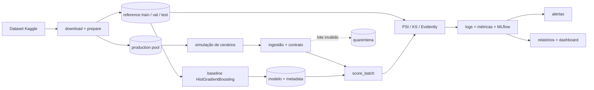

# Credit Scoring Observability

Tech Challenge Fase 4 (Pós Tech MLET): camada de **sustentação e confiabilidade** para um modelo de Credit Scoring, com contratos de qualidade de dados, simulação e detecção de drift, observabilidade e governança (LGPD).

> Plano de execução do time: [`docs/PLANO_TRABALHO.md`](docs/PLANO_TRABALHO.md) · contratos de integração: [`docs/contracts.md`](docs/contracts.md) · **vídeo (STAR, ≤ 5 min):** _link a inserir em 13/11_ (§16).

## Sumário

1. [Problema e objetivo](#1-problema-e-objetivo) · 2. [Arquitetura](#2-arquitetura) · 3. [Dataset e limitações](#3-dataset-e-limitações) · 4. [Instalação](#4-instalação) · 5. [Execução](#5-execução) · 6. [Contratos de dados](#6-contratos-de-dados) · 7. [Modelo baseline](#7-modelo-baseline) · 8. [Simulação de drift](#8-simulação-de-drift) · 9. [Resultados estatísticos](#9-resultados-estatísticos) · 10. [Observabilidade](#10-observabilidade) · 11. [Evidências](#11-evidências) · 12. [Governança e LGPD](#12-governança-e-lgpd) · 13. [Análise causal](#13-análise-causal) · 14. [Testes](#14-testes) · 15. [Limitações](#15-limitações-e-trabalhos-futuros) · 16. [Integrantes e vídeo](#16-integrantes-e-link-do-vídeo)

---

## 1. Problema e objetivo

Uma fintech de concessão de crédito tem um modelo de Credit Scoring em produção. Com mudanças na economia (inflação, novos perfis de clientes), a diretoria suspeita de **degradação silenciosa**: o modelo continua respondendo, mas as decisões podem estar erradas. Em crédito isso é especialmente perigoso porque o rótulo (inadimplência) só chega **meses depois** da decisão; sem monitoramento, a queda de desempenho só aparece quando o prejuízo já se materializou.

O objetivo deste repositório é construir a **camada de sustentação** em volta de um classificador simples, cobrindo as quatro etapas do desafio:

| Etapa | O que entregamos | Onde |
|---|---|---|
| 1. Validação de dados | Contrato Pandera com 5 regras BLOCK e 2 WARN que **impede** que um lote inválido chegue ao modelo (quarentena + alerta CRITICAL) | `src/creditwatch/contracts/`, `config/contract.yaml` |
| 2. Drift | Simulação de cenários de Data Drift (e Concept Drift sintético) a partir de um pool de produção separado do treino; detecção com PSI, KS e Evidently; relatório HTML por lote | `src/creditwatch/simulation/`, `src/creditwatch/drift/`, `config/drift_scenarios.yaml` |
| 3. Observabilidade | Logs JSON por estágio, `run_history.jsonl`, MLflow (um run por lote), motor de alertas A01–A06 e dashboard HTML offline | `src/creditwatch/observability/`, `docs/observability_metrics.md` |
| 4. Governança | Inventário de dados, base legal, retenção, controle de acesso, vieses e análise causal, com rótulos Observado / Hipótese / Não testado | §12, §13, `docs/governance/` |

Fluxo em uma linha: **lote → contrato (bloqueia lixo) → scoring → drift (PSI + KS + Evidently) → logs + métricas + MLflow → alertas → relatórios/dashboard**.

## 2. Arquitetura



Detalhes e decisões em [`docs/architecture.md`](docs/architecture.md). O pipeline (`creditwatch.pipeline.run`) processa cada lote em seis estágios — `ingest → validate → score → drift → observe → alert` — e devolve exit code `0` (ok), `2` (bloqueado pelo contrato) ou `3` (erro).

```text
config/            # YAMLs: dados, contrato, modelo, cenários de drift, thresholds, alertas
data/              # NÃO versionado (ver data/README.MD)
docs/              # contratos, ADRs, governança, evidências, roteiro do vídeo
notebooks/         # só exploração (EDA)
src/creditwatch/   # data, model, contracts, simulation, drift, observability, pipeline
tests/             # unit (+ integration/e2e)
artifacts/         # gerado pelo pipeline; NÃO versionado
```

## 3. Dataset e limitações

**Give Me Some Credit** (Kaggle, `cs-training.csv`): 150.000 linhas, 10 features numéricas e target binário `SeriousDlqin2yrs` (atraso ≥ 90 dias em 2 anos; ~6,7% positivos). Decisão e medições em [ADR-001](docs/decisions/ADR-001-dataset.md); obtenção e SHA-256 em [`data/README.MD`](data/README.MD).

Após limpeza (idade inválida, códigos especiais 96/98 → NaN, **remoção das 19,8% de linhas com renda nula**, duplicatas) restam 119.001 linhas, divididas por `customer_id` sem interseção: `reference_train` 60% (71.400) · `reference_val` 10% (11.900) · `reference_test` 10% (11.900) · `production_pool` 20% (~23.800). O pool **nunca** entra no treino: ele é a "produção" de onde os lotes simulados são amostrados.

Limitações: dataset de 2011 (EUA), sem atributos sensíveis (sexo, raça), sem datas reais; a remoção de renda nula muda o perfil da amostra (taxa do target 5,6% × 7,0%). Uso sujeito aos termos da competição Kaggle; o CSV não é redistribuído.

## 4. Instalação

Pré-requisitos: [uv](https://docs.astral.sh/uv/) e Git (o Python 3.12 é instalado pelo uv). No Windows sem `make`, use os comandos `uv run ...` equivalentes do `Makefile`.

```bash
git clone https://github.com/NicolasRM370990/credit-scoring-observability.git
cd credit-scoring-observability
make setup        # uv sync
# baixe o cs-training.csv do Kaggle para data/raw/ (ver data/README.MD)
make data         # confere o SHA-256 e gera data/processed/full.parquet
make prepare      # gera os quatro splits estratificados
make train        # treina o baseline e grava modelo/métricas
make test         # pytest
```

## 5. Execução

```bash
make demo-smoke       # seis estágios com stubs; valida o formato dos logs
make demo             # cenários no_drift, covariate_moderate, covariate_severe e invalid
make demo-video       # versão determinística (run_id fixo) usada na gravação
make dashboard        # artifacts/dashboard/index.html
make mlflow-ui        # http://127.0.0.1:5000 (backend SQLite em mlflow/mlflow.db)
make mlflow-training  # registra o metadata do baseline no experimento de treino
make alerts-summary   # resumo de alertas e execuções no terminal
make evidence         # copia dashboard, alerts e run_history (leves) para docs/evidence/
make bias             # análise descritiva por faixa etária
make evaluate-labeled # desempenho em lotes rotulados (concept drift)
```

Saídas geradas (não versionadas): `artifacts/{logs,metrics,alerts,drift,scored,dashboard}/`, `data/quarantine/`, `mlflow/`.

## 6. Contratos de dados

Contrato **v1.0.0** em [`config/contract.yaml`](config/contract.yaml), executado por `contracts/validate.py` (Pandera, `lazy=True`) e `contracts/ingestion.py`. Qualquer falha em regra **BLOCK** rejeita o lote inteiro: o arquivo vai para `data/quarantine/`, **nenhuma predição é gerada**, o pipeline retorna exit code 2 e o alerta `A01_VALIDATION_BLOCKED` (CRITICAL) é emitido.

| Regra | Severidade | Condição |
|---|---|---|
| `R01_AGE_RANGE` | BLOCK | `age` entre 18 e 110 |
| `R02_INCOME` | BLOCK | `monthly_income` não nulo, entre 0 e 25.000 |
| `R03_NO_DUPLICATES` | BLOCK | sem `customer_id` repetido nem linha inteira duplicada |
| `R04_SCHEMA` | BLOCK | colunas obrigatórias presentes; nulos só nas colunas permitidas; `target` (se presente) binário |
| `R05_NONNEG` | BLOCK | `revolving_utilization`, `debt_ratio`, `open_credit_lines`, `real_estate_loans` ≥ 0 |
| `W01_NULL_RATE` | WARN | taxa de nulos por coluna ≤ 5% |
| `W02_MIN_VOLUME` | WARN | lote com ≥ 1.000 linhas |

O `ValidationResult` (schema em `interfaces.py`) registra, por regra, contagem e taxa de falhas e **apenas o índice** das linhas com problema — nunca valores (§12). _Detalhes de testes dos lotes inválidos: P2._

## 7. Modelo baseline

`HistGradientBoostingClassifier` (scikit-learn) em `Pipeline`, seed 42, treinado em `reference_train` (métricas em [`models/baseline_v1.json`](models/baseline_v1.json)):

| Conjunto | ROC-AUC | PR-AUC | KS | Brier | Precisão | Recall |
|---|---:|---:|---:|---:|---:|---:|
| validação | 0,860 | 0,405 | 0,567 | 0,051 | 0,427 | 0,473 |
| **teste** | **0,860** | 0,386 | 0,565 | 0,051 | 0,430 | 0,486 |
| dummy (teste) | 0,500 | 0,070 | 0,000 | 0,065 | — | — |

Threshold operacional **0,2376** (maximiza F1 na validação; custos operacionais e calibração não foram fornecidos — registrado no metadata). Aprovação = `prediction = 0`. Com classe desbalanceada (~7%), acurácia não é usada.

## 8. Simulação de drift

Cenários em [`config/drift_scenarios.yaml`](config/drift_scenarios.yaml) (`simulation/scenarios.py` e `generate.py`, P3). Cada cenário é uma sequência de lotes de 3.000 linhas amostrados do pool, com `event_date` crescente e intensidade progressiva (`ramp: linear`). `age` e `dependents` **nunca** são alteradas: são as variáveis de controle que mostram que o detector não sinaliza tudo.

| Cenário | Lotes | Alteração | Finalidade |
|---|---:|---|---|
| `no_drift` | 4 | nenhuma | controle: não deve alertar |
| `covariate_moderate` | 4 | `monthly_income` ×1,25 (renda nominal inflada); `revolving_utilization` +0,15 | Data Drift em 2 variáveis |
| `covariate_severe` | 6 | `monthly_income` ×1,40; `revolving_utilization` +0,30; `debt_ratio` ×1,60 | Data Drift em 3 variáveis |
| `concept_drift` | 4 | covariáveis iguais; rótulos sintéticos com `logit_offset: 0.8` | mostrar que P(y\|X) pode mudar sem drift em P(X) |
| `_invalid/*` | 1 por regra | uma violação por lote (ex.: `age = 17`) | provar o bloqueio do contrato |

## 9. Resultados estatísticos

_Seção de P3 (E2-08/E2-09)._ Tabela "esperado × observado" por cenário com `drift_share`, PSI e KS por feature, e relatório Evidently apontando as variáveis degradadas. Thresholds iniciais por convenção (`config/drift_thresholds.yaml`: PSI 0,10 warn / 0,25 critical; KS ≥ 0,10; `drift_share` ≥ 0,30), a calibrar em `docs/thresholds.md`.

<!-- P3: inserir tabela esperado x observado e links para artifacts/drift/<lote>.html copiados em docs/evidence/ -->

## 10. Observabilidade

Implementada em `src/creditwatch/observability/` (P4). Tudo o que o pipeline produz é agregado por lote; **nenhum valor de linha de dados** é gravado em log, métrica, alerta ou dashboard.

| Camada | Arquivo / ferramenta | O que registra |
|---|---|---|
| **Logs** | `artifacts/logs/pipeline.jsonl` (`observability/logging.py`) | uma linha JSON por evento com `ts, level, run_id, batch_id, stage, event, status, duration_ms, n_rows, message, extra`; `stage_timer`/`@stage` registram início, fim, duração e falhas; `sanitize_extra` redige qualquer chave com nome de coluna do dataset |
| **Métricas** | `artifacts/metrics/run_history.jsonl` (`observability/metrics.py`) | uma linha `RunMetrics` por execução (upsert por `run_id`): status, volume, latência, `drift_share`, PSI/KS por feature, score médio, contagem de alertas |
| **MLflow** | `mlflow/mlflow.db` (SQLite) + `mlflow/artifacts/` (`observability/mlflow_tracker.py`) | experimento `credit-scoring-monitoring`: um run por lote (nome = `batch_id`; tags `scenario`, `status`, `model_version`, `contract_version`; métricas achatadas `psi_<feature>`, `latency_total_s`…; artefatos: JSON da execução, HTML do Evidently, `alerts.json`). Experimento `credit-scoring-training`: metadata do baseline |
| **Alertas** | `artifacts/alerts/alerts.jsonl` (`observability/alerts.py`, regras em `config/alerts.yaml`) | A01 lote bloqueado (CRITICAL) · A02 `drift_share` ≥ 0,30 · A03 PSI ≥ 0,25 por feature (CRITICAL) · A04 latência > 120 s · A05 volume fora de [1.000, 10.000] · A06 PSI dos scores > 0,10 |
| **Dashboard** | `artifacts/dashboard/index.html` (`observability/dashboard.py`, Jinja2 + Plotly, abre offline) | cards de saúde (execuções ok/bloqueadas/erro, linhas, alertas), latência e volume por lote, `drift_share` por cenário, heatmap de PSI feature × lote, tabelas de execuções e alertas |

Métricas de saúde documentadas (nome, definição, unidade, fonte, alerta) em [`docs/observability_metrics.md`](docs/observability_metrics.md); o teste `test_metrics_catalog.py` garante que o catálogo e `RunMetrics` não divergem.

**Como ler um incidente:** `make demo` → o lote `invalid_age` termina com exit 2, uma linha `pipeline_status=blocked` em `run_history`, um `A01` em `alerts.jsonl`, um run com tag `status=blocked` no MLflow e o card "bloqueadas pelo contrato" do dashboard sobe. No `covariate_severe`, os últimos lotes geram `A02` + `A03` para `monthly_income`/`revolving_utilization`, visíveis no heatmap de PSI e no relatório Evidently anexado ao run.

## 11. Evidências

Geradas por `make demo && make evidence` e versionadas (leves) em [`docs/evidence/`](docs/evidence/):

| Evidência | Arquivo | Status |
|---|---|---|
| Relatório de viés por faixa etária | [`bias_report.md`](docs/evidence/bias_report.md) | disponível |
| Dashboard de monitoramento (HTML, via CDN) | `docs/evidence/dashboard.html` | gerado por `make evidence` após `make demo` |
| Alertas e histórico da demo | `docs/evidence/alerts.jsonl`, `docs/evidence/run_history.jsonl` | idem |
| Relatório Evidently de um lote com drift | `docs/evidence/drift_covariate_severe_b06.html` | P3 copia após `make demo` |
| Print do MLflow (lista de runs) e do contrato bloqueando | `docs/evidence/mlflow_runs.png`, `docs/evidence/contract_blocked.png` | a capturar na demo final |

<!-- P4: após rodar make demo com os dados, substituir os "a capturar" por links reais -->

## 12. Governança e LGPD

> **Aviso:** esta seção é um exercício acadêmico sobre um dataset público e **não constitui parecer jurídico**. Os artigos citados são da Lei 13.709/2018 (LGPD) e devem ser conferidos na fonte oficial; a aplicação a um caso real exige validação de um profissional jurídico e do encarregado (DPO).

### 12.1 Dados pessoais tratados e minimização

O inventário completo coluna → classificação → onde aparece → tratamento está em [`docs/governance/data_inventory.md`](docs/governance/data_inventory.md). Resumo:

- O dataset **não traz identificadores diretos** (nome, CPF, conta). `customer_id` é um **pseudônimo** gerado no `prepare` (art. 13, §4º). **Não afirmamos anonimização** (art. 12): `age + monthly_income + dependents + histórico de atraso` são quase-identificadores e poderiam permitir reidentificação com bases auxiliares em um cenário real.
- **Não há dados sensíveis** (art. 5º, II; art. 11) e o projeto não deve incluí-los. Consequência: a análise de vieses fica restrita a faixa etária.
- **Minimização (art. 6º, III):** logs, métricas, alertas, MLflow e dashboard só carregam contagens, durações, estatísticas agregadas e índices de linha. O `ValidationResult` registra `row_index`, nunca o valor. Isso é garantido por código (`sanitize_extra` redige qualquer chave com nome de coluna) e por teste (`tests/unit/test_governance_logs.py`).
- `data/`, `artifacts/`, `mlflow/`, modelos `.joblib`, `.env` e `kaggle.json` ficam **fora do Git**.

### 12.2 Base legal para a decisão de crédito (hipótese adotada)

Não existe base legal "automática": é uma escolha a justificar. Para a fintech fictícia adotamos:

| Tratamento | Base legal adotada | Justificativa | Alternativas consideradas |
|---|---|---|---|
| Análise do pedido de crédito e scoring | **Procedimentos preliminares / execução de contrato a pedido do titular (art. 7º, V)** | o cliente solicita o crédito; a análise é etapa necessária do contrato | Consentimento (art. 7º, I): frágil e revogável, não sustenta sozinho uma decisão de crédito |
| Prevenção à inadimplência e gestão de risco da carteira | **Proteção do crédito (art. 7º, X)** | hipótese expressa na lei para o setor; exige finalidade e necessidade claras (art. 6º, I e III) | Obrigação legal/regulatória (art. 7º, II): citar apenas se houver norma concreta aplicável (ex.: normativos do BCB), a confirmar |
| Monitoramento de drift, retreino e melhoria do modelo | **Legítimo interesse (art. 7º, IX; art. 10)** | manter o modelo correto protege titular e instituição; exige teste de balanceamento (LIA) documentado e uso de dados pseudonimizados/agregados | Consentimento: desproporcional para uso interno agregado |

Compromissos decorrentes: princípios do art. 6º (finalidade, adequação, necessidade, transparência, segurança, prevenção, **não discriminação**, responsabilização); **direito à revisão de decisões automatizadas (art. 20)** — o titular pode pedir revisão e informações claras sobre os critérios; registro das operações de tratamento (art. 37); **Relatório de Impacto (RIPD, art. 38)** recomendado dado o uso de scoring e o risco de discriminação; segurança (arts. 46–49). Legislação setorial de crédito (ex.: Lei 12.414/2011, Cadastro Positivo) só deve ser invocada depois de conferido o texto aplicável.

O que um jurídico real precisaria validar: enquadramento exato das bases por finalidade, conteúdo do LIA, texto das informações ao titular (art. 9º), fluxo de revisão humana do art. 20, prazos de retenção e eventual compartilhamento com bureaus.

### 12.3 Retenção e descarte (proposta)

Prazos **propostos** (decisão de projeto, não valor legal), detalhados em `data_inventory.md` §4: dados brutos só pelo tempo da finalidade (arts. 15–16); lotes e quarentena 90 dias; predições por cliente 5 anos em ambiente real (revisão/contestação, art. 20 — a confirmar); logs, métricas e alertas agregados 12 meses (trilha de auditoria, art. 37); modelo e metadata enquanto em uso + 5 anos (explicar decisões passadas).

### 12.4 Controle de acesso

Por papel: engenharia de dados (dados completos e quarentena), ciência de dados (dados pseudonimizados e modelo), observabilidade/SRE (**só** logs, métricas, alertas, MLflow e dashboard), negócio/auditoria/DPO (relatórios agregados). Com dados reais: armazenamento cifrado, autenticação por papel e registro de acesso (arts. 46–47). Segredos nunca entram no repositório.

### 12.5 Vieses e não discriminação

Análise descritiva por faixa etária em [`docs/evidence/bias_report.md`](docs/evidence/bias_report.md) (`make bias`): taxa de aprovação varia de 86,6% (18–29) a 97,3% (60+), razão 0,89; recall cai de 0,55 para 0,28 no grupo 60+. São **métricas descritivas** que dependem do threshold e da amostra; **não provam discriminação nem a ausência dela**, e o dataset não permite avaliar sexo ou raça. Mitigações propostas: revisão humana de decisões contestadas (art. 20), monitoramento periódico das diferenças por grupo junto com o drift, avaliação de atributos permitidos com revisão jurídica e análise de viés de seleção (só clientes aprovados têm rótulo).

## 13. Análise causal

> Cada afirmação está rotulada como **Observado** (medido neste repositório), **Hipótese** (mecanismo plausível, não comprovado) ou **Não testado** (exigiria dados/experimentos que não temos). Correlação com drift **não prova** causa nem queda de desempenho.

### 13.1 DAG da hipótese

```mermaid
flowchart TD
  ECON[Choque econômico: inflação] -->|Hipótese| RENDA[Renda nominal aparente ↑]
  ECON -->|Hipótese| CUSTO[Custo de vida ↑]
  CUSTO -->|Hipótese| UTIL[revolving_utilization ↑]
  CUSTO -->|Hipótese| DEBT[debt_ratio ↑]
  RENDA -->|Observado na simulação| SCORE[Score de risco ↓ (modelo lê renda alta como protetora)]
  UTIL --> SCORE
  DEBT --> SCORE
  UTIL -->|Hipótese| INAD[Inadimplência real ↑]
  DEBT -->|Hipótese| INAD
  SCORE -.->|Hipótese: subestimação do risco| GAP[Gap entre risco previsto e real]
  INAD -.-> GAP
  MIX[Mudança do mix de clientes / canais] -.->|Confundidor| UTIL
  POL[Mudança de política de crédito] -.->|Confundidor| INAD
  SEL[Viés de seleção: só aprovados têm rótulo] -.->|Confundidor| INAD
```

### 13.2 O que foi observado, o que é hipótese, o que não foi testado

| Afirmação | Rótulo | Evidência / o que faltaria |
|---|---|---|
| Nos cenários `covariate_*`, as features alteradas (`monthly_income`, `revolving_utilization`, `debt_ratio`) apresentam PSI/KS crescentes com a intensidade do lote, e as de controle (`age`, `dependents`) não | **Observado** (simulação) | `DriftResult` por lote; heatmap de PSI no dashboard; alertas A02/A03 — _P3 insere os números em §9_ |
| A distribuição dos scores muda nos lotes com drift (`score_psi`, `score_mean`) | **Observado** (simulação) | `run_history.jsonl`, alerta A06 |
| O cenário `no_drift` não gera alerta CRITICAL de drift | **Observado** (simulação) | tabela esperado × observado (§9) |
| Drift em P(X) **causa** queda de desempenho | **Hipótese** | só confirmável com rótulos; o cenário `concept_drift` mostra o oposto: desempenho cai com P(X) estável (`make evaluate-labeled`, `docs/evidence/perf_vs_drift.md`, P1/P3) |
| Inflação é a causa do aumento de renda nominal e de utilização | **Hipótese** | nossa simulação **gera** esse mecanismo; em produção seria preciso cruzar com séries macro e datas |
| O modelo subestima o risco quando a renda nominal infla sem ganho real | **Hipótese** (coerente com a direção do score observada) | exigiria rótulos pós-choque ou experimento controlado |
| Efeito isolado de cada variável sobre o score e o desempenho | **Observado apenas na simulação** via ablação (uma variável alterada por vez) | `scripts/causal_ablation.py`, `docs/evidence/ablation.md` (E4-05, P3) — _inserir tabela feature × Δscore × Δdesempenho_ |
| Confundidores: sazonalidade, mix de clientes/canais, mudança de política de crédito, viés de seleção, falhas no pipeline de dados | **Não testado** | não há datas reais nem metadados de canal no dataset |

### 13.3 O que seria necessário no mundo real

Grupo de controle ou janela pré/pós com diferença-em-diferenças; séries temporais com datas de eventos econômicos; inferência de rejeitados para corrigir o viés de seleção; rótulos com atraso conhecido para medir desempenho por safra; e registro de mudanças de política para separar efeito do modelo de efeito da regra de negócio. Até lá, o drift detectado é um **gatilho de investigação**, não um diagnóstico.

## 14. Testes

`make test` (pytest) e `make lint` (ruff) rodam na CI (`.github/workflows/ci.yaml`) em cada PR. Cobertura por módulo: preparo e splits, contrato (cada regra e cada lote inválido), simulação (determinismo, colunas intocadas), modelo (AUC acima do dummy, scores em [0,1]), observabilidade (logs com campos mínimos, upsert do histórico, cada regra de alerta dispara só quando deve, MLflow com um run por lote, dashboard, catálogo de métricas) e governança (`test_logs_do_not_contain_row_values`). _Testes de integração e2e: P2 (E2-13)._

## 15. Limitações e trabalhos futuros

_Seção de P3 (com contribuições de todos)._ Pontos já conhecidos: thresholds por convenção (não calibrados); concept drift só com rótulos sintéticos; dataset sem atributos sensíveis e sem datas reais; `age` tratada como quase-identificador; alerta de latência medido em máquina local; sem Prometheus/Grafana (opcional no enunciado); modelo não calibrado.

## 16. Integrantes e link do vídeo

| Pessoa | Papel | Módulos |
|---|---|---|
| P1 — _nome_ | Dados, Modelo e Integração (dono da `main`) | `data/`, `model/`, `pipeline/`, `interfaces.py` |
| P2 — _nome_ | Contratos, Testes e Vídeo | `contracts/`, `tests/`, CI, gravação |
| P3 — _nome_ | Drift e Simulação | `simulation/`, `drift/`, ablação causal |
| P4 — _nome_ | Observabilidade, Governança e Docs | `observability/`, `docs/`, README, roteiro |

**Vídeo (STAR, ≤ 5 min):** _link a inserir em 13/11_ · roteiro em [`docs/video/roteiro_star.md`](docs/video/roteiro_star.md).

<!-- Trocar "_nome_" pelos nomes e RMs; inserir o link do vídeo (testar em janela anônima) -->
