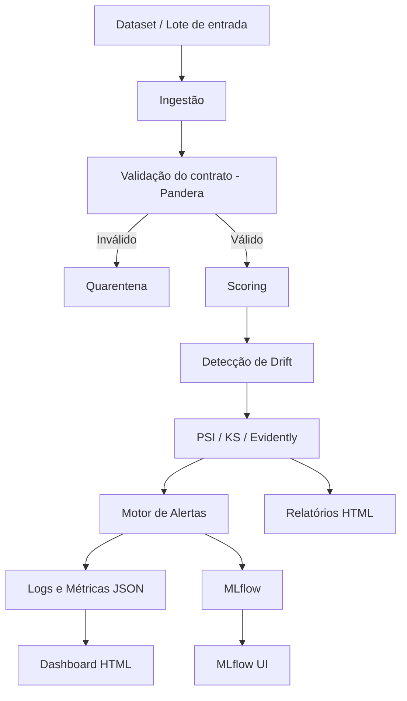

# Credit Scoring Observability

**Tech Challenge --- Fase 4 \| Machine Learning Engineering**

Plataforma de observabilidade e monitoramento contínuo para um sistema
de Credit Scoring, com foco em qualidade de dados, detecção de *data
drift*, confiabilidade operacional, rastreabilidade e governança.

O projeto implementa uma camada de sustentação para modelos de Machine
Learning, permitindo validar dados de entrada, simular mudanças de
distribuição, monitorar o comportamento do modelo e registrar alertas e
métricas de execução.

> **Escopo:** demonstra mecanismos de monitoramento e confiabilidade de
> um pipeline de Credit Scoring. Não representa um sistema de concessão
> de crédito pronto para uso comercial.

------------------------------------------------------------------------

## 1. Objetivo

Modelos de Machine Learning podem apresentar degradação ao longo do
tempo devido a mudanças no perfil dos dados recebidos, nas
características da população ou no comportamento das variáveis
utilizadas durante o treinamento.

O objetivo deste projeto é desenvolver uma estrutura capaz de:

-   Validar a qualidade dos dados antes do processamento.
-   Bloquear lotes que violem regras do contrato de dados.
-   Simular cenários controlados de mudança de distribuição.
-   Detectar *data drift* por meio de métodos estatísticos.
-   Monitorar métricas de desempenho e saúde do pipeline.
-   Registrar execuções, métricas e artefatos no MLflow.
-   Gerar relatórios e dashboards.
-   Aplicar práticas de segurança, privacidade e governança.

## 2. Arquitetura

A arquitetura separa ingestão, validação, scoring, detecção de drift e
observabilidade.



### Componentes

  -----------------------------------------------------------------------
  Componente              Responsabilidade        Tecnologia
  ----------------------- ----------------------- -----------------------
  Ingestão                Receber e preparar os   Python / Pandas
                          lotes                   

  Data Contract           Validar regras de       Pandera
                          qualidade               

  Modelo                  Treinar e gerar scores  Scikit-learn

  Simulação               Criar cenários          Pandas / NumPy
                          controlados de drift    

  Drift Detection         Comparar distribuições  Evidently / PSI / KS

  Alertas                 Avaliar regras          Python / YAML
                          configuradas            

  Tracking                Registrar métricas e    MLflow
                          artefatos               

  Dashboard               Consolidar resultados   Jinja2 / Plotly

  Testes                  Validar comportamento,  Pytest / Ruff
                          segurança e desempenho  
  -----------------------------------------------------------------------

### Estrutura do projeto

``` text
credit-scoring-observability/
├── config/                 # Configurações YAML
├── data/                   # Dados locais (não versionados)
├── docs/
│   ├── decisions/          # Architecture Decision Records
│   ├── evidence/           # Evidências e resultados
│   ├── architecture.md
│   ├── contracts.md
│   ├── observability_metrics.md
│   ├── thresholds.md
│   └── PLANO_TRABALHO.md
├── models/                 # Metadados e artefatos do modelo
├── notebooks/              # EDA
├── scripts/                # Scripts auxiliares
├── src/creditwatch/
│   ├── contracts/
│   ├── data/
│   ├── drift/
│   ├── model/
│   ├── observability/
│   ├── pipeline/
│   └── simulation/
├── tests/
│   ├── functional/
│   ├── integration/
│   ├── pentest/
│   ├── performance/
│   ├── regression/
│   ├── security/
│   ├── smoke/
│   └── unit/
├── .github/workflows/
├── Makefile
├── pyproject.toml
├── uv.lock
└── README.md
```

## 3. Dataset

O projeto utiliza o dataset **Give Me Some Credit**, disponibilizado por
meio da competição homônima no Kaggle.

O conjunto contém informações financeiras e comportamentais utilizadas
para estudar risco de inadimplência. O problema é tratado como
classificação binária, com variáveis numéricas relacionadas à utilização
de crédito, idade, renda e histórico de atrasos.

O processamento contempla tratamento de duplicidades, valores ausentes e
inconsistências, além da preparação de conjuntos separados para
treinamento, validação, teste e simulação.

**O dataset não é distribuído neste repositório.** Obtenha
`cs-training.csv` no Kaggle e respeite os termos de uso aplicáveis.

Consulte [ADR-001 --- Dataset](docs/decisions/ADR-001-dataset.md) e
[data/README.md](data/README.md).

## 4. Tecnologias

  Tecnologia        Aplicação
  ----------------- ------------------------------------------
  Python 3.12       Linguagem principal
  uv                Ambiente e dependências
  Pandas / NumPy    Manipulação de dados
  Scikit-learn      Treinamento e avaliação
  Pandera           Contratos e validação
  Evidently         Análise de mudanças de distribuição
  SciPy             Testes estatísticos
  MLflow            Rastreamento de experimentos e execuções
  Plotly / Jinja2   Dashboard HTML
  Pytest            Testes automatizados
  Ruff              Qualidade e padronização
  PyYAML            Configurações

## 5. Instalação

### Pré-requisitos

-   Git
-   Python 3.12
-   [uv](https://docs.astral.sh/uv/)
-   GNU Make, opcional para utilizar os atalhos do Makefile.

### Clonar e instalar

``` bash
git clone https://github.com/NicolasRM370990/credit-scoring-observability.git
cd credit-scoring-observability
uv sync
```

O projeto utiliza Python 3.12, definido na configuração do ambiente.

### Dataset

Obtenha `cs-training.csv` no Kaggle e coloque-o no diretório indicado
por `data/README.md`, normalmente:

``` text
data/raw/cs-training.csv
```

Depois, execute as etapas de preparação conforme os comandos
documentados no Makefile e nos módulos do projeto.

## 6. Execução

Para consultar as opções disponíveis na CLI:

``` bash
uv run python -m creditwatch.pipeline.run --help
```

### Smoke test

``` bash
uv run python -m creditwatch.pipeline.run --smoke
```

A execução smoke verifica os estágios e o formato dos registros sem
depender da execução completa dos cenários.

### Cenários de monitoramento

``` bash
uv run python -m creditwatch.pipeline.run --scenario no_drift
uv run python -m creditwatch.pipeline.run --scenario covariate_moderate
uv run python -m creditwatch.pipeline.run --scenario covariate_severe
uv run python -m creditwatch.pipeline.run --scenario invalid
```

### Demonstração completa

``` bash
uv run python -m creditwatch.pipeline.run --demo-video
```

### Preparação, treinamento e Makefile

O projeto disponibiliza comandos de preparação, treinamento e avaliação
no Makefile. Consulte os alvos existentes antes de executar:

``` bash
Get-Content Makefile
```

No Windows, caso GNU Make não esteja instalado, utilize os módulos
Python com `uv run`, conforme as instruções do projeto.

## 7. Contratos e qualidade dos dados

A validação ocorre antes do scoring. O contrato utiliza Pandera para
verificar regras estruturais e de qualidade, incluindo tipos, faixas e
consistência dos dados.

O fluxo contempla:

1.  Recebimento do lote.
2.  Validação do contrato.
3.  Identificação das violações.
4.  Bloqueio da ingestão quando necessário.
5.  Encaminhamento de lotes inválidos para quarentena.
6.  Continuidade do pipeline somente quando a validação permite.

Consulte [docs/contracts.md](docs/contracts.md).

## 8. Modelo baseline

O projeto utiliza o **HistGradientBoostingClassifier**, do Scikit-learn,
para produzir scores e previsões acompanhados pelo pipeline de
observabilidade.

A avaliação considera métricas de classificação e comparação com um
modelo de referência simples (*Dummy Classifier*).

O projeto mantém informações do baseline em `models/baseline_v1.json`. O
processo de scoring também verifica a integridade do artefato do modelo
por meio de hash SHA-256.

Os resultados devem ser interpretados considerando a natureza do dataset
e as limitações dos dados disponíveis.

## 9. Simulação e detecção de drift

A solução implementa cenários controlados para avaliar a capacidade de
identificar mudanças na distribuição dos dados.

  -----------------------------------------------------------------------
  Cenário                 Objetivo                Resultado esperado
  ----------------------- ----------------------- -----------------------
  `no_drift`              Dados semelhantes à     Ausência de drift
                          referência              relevante

  `covariate_moderate`    Mudanças moderadas nas  Identificação de
                          variáveis               alterações

  `covariate_severe`      Mudanças mais intensas  Maior proporção de
                                                  variáveis sinalizadas

  `invalid`               Dados que violam o      Bloqueio da ingestão
                          contrato                
  -----------------------------------------------------------------------

### Métodos estatísticos

-   **Population Stability Index (PSI):** compara a distribuição de uma
    variável entre a população de referência e a população atual.
-   **Kolmogorov-Smirnov (KS):** compara duas distribuições por meio da
    maior distância entre suas funções de distribuição acumulada.
-   **Evidently:** complementa a análise com relatórios de monitoramento
    e comparação das distribuições.

Os parâmetros de monitoramento são configurados em
`config/drift_thresholds.yaml`. São parâmetros operacionais do projeto,
não limites universais de significância estatística. Consulte
[docs/thresholds.md](docs/thresholds.md).

### Concept Drift

O projeto também contempla uma experiência com rótulos sintéticos para
ilustrar uma possível mudança na relação entre as variáveis de entrada e
o resultado esperado.

Esse cenário é experimental: os rótulos são gerados artificialmente e
não representam uma mudança causal observada em uma população real.
*Data drift* e *concept drift* são fenômenos diferentes e exigem
mecanismos de monitoramento distintos.

Evidência:
[docs/evidence/perf_vs_drift.md](docs/evidence/perf_vs_drift.md).

## 10. Observabilidade e monitoramento

A camada de observabilidade centraliza informações sobre a execução do
pipeline e o comportamento dos lotes.

### Métricas monitoradas

-   Status da execução.
-   Duração total e duração por estágio.
-   Linhas recebidas, válidas e rejeitadas.
-   Lotes bloqueados.
-   PSI por variável.
-   Estatística KS por variável.
-   Proporção de variáveis com drift (`drift_share`).
-   Média dos scores.
-   PSI das predições.
-   Quantidade de alertas por severidade.

### Motor de alertas

As regras são declaradas em `config/alerts.yaml`.

  Regra   Condição monitorada                Severidade
  ------- ---------------------------------- ------------
  A01     Lote bloqueado por validação       CRITICAL
  A02     Drift global do dataset            WARNING
  A03     PSI crítico por variável           CRITICAL
  A04     Latência acima do limite           WARNING
  A05     Volume fora da faixa configurada   WARNING
  A06     Drift na distribuição dos scores   WARNING

Os alertas são registrados em arquivos JSONL para permitir análise
posterior e rastreabilidade por execução.

### MLflow

O MLflow registra métricas, identificação das execuções, versões do
modelo e do contrato, cenários e artefatos relacionados ao
processamento.

Para iniciar a interface local:

``` bash
uv run mlflow ui --backend-store-uri sqlite:///mlflow/creditwatch.db --host 127.0.0.1 --port 5000 --workers 1
```

Acesse: http://127.0.0.1:5000

### Dashboard HTML

O dashboard estático utiliza Jinja2 e Plotly e apresenta:

-   Total de execuções.
-   Quantidade de lotes bloqueados.
-   Linhas processadas.
-   Alertas registrados.
-   Status e duração das execuções.
-   PSI máximo e `drift_share`.
-   Histórico de execuções e alertas.

Arquivo gerado: `artifacts/dashboard/index.html`.

O HTML inclui os recursos necessários do Plotly e pode ser aberto
localmente sem depender de uma conexão externa para carregar a
biblioteca de visualização.

### Catálogo de métricas

As definições, unidades, fontes e alertas associados estão em
[docs/observability_metrics.md](docs/observability_metrics.md).

## 11. Evidências

  -------------------------------------------------------------------------------------
  Evidência                           Arquivo
  ----------------------------------- -------------------------------------------------
  Relatório de drift                  `docs/evidence/e2-06-drift-report.png`

  Evolução do PSI                     `docs/evidence/e2-06-psi-evolution.png`

  Análise descritiva por idade        `docs/evidence/bias_report.md`

  Comparação de desempenho e drift    `docs/evidence/perf_vs_drift.md`

  Calibração de thresholds            `docs/evidence/drift_threshold_calibration.csv`

  Dashboard de observabilidade        `docs/evidence/e2-14-dashboard.png`
  -------------------------------------------------------------------------------------

Relatórios HTML e JSON gerados durante as execuções ficam nos diretórios
de artefatos correspondentes.

## 12. Governança, privacidade e segurança

O projeto considera princípios de governança e proteção de dados
aplicáveis ao contexto de análise de crédito.

As práticas contempladas incluem:

-   Validação dos dados antes do processamento.
-   Rastreabilidade das execuções.
-   Registro de métricas sem exposição desnecessária dos valores
    individuais das linhas.
-   Verificação da integridade do artefato do modelo.
-   Testes relacionados à privacidade e à LGPD.
-   Análise descritiva de resultados por faixa etária.
-   Separação entre dados de referência e dados de produção simulados.

A análise de viés implementada é descritiva e não comprova,
isoladamente, ausência de discriminação ou conformidade legal.

O uso real de um modelo em decisões de crédito exige avaliação jurídica,
definição de base legal, controles de acesso, política de retenção,
explicabilidade e supervisão humana apropriados ao contexto de
implantação.

## 13. Causalidade e limitações

A identificação de mudanças na distribuição dos dados não demonstra, por
si só, que essas mudanças causaram uma degradação na qualidade das
previsões. Da mesma forma, uma associação estatística entre variáveis
não comprova uma relação causal.

### Limitações

-   O dataset é histórico e pode não representar uma população atual.
-   Os cenários de produção são simulados.
-   Os rótulos sintéticos não substituem observações reais.
-   Os thresholds precisam ser reavaliados em novos contextos.
-   O projeto não implementa integração com um sistema real de concessão
    de crédito.
-   O monitoramento de drift não substitui a avaliação periódica do
    desempenho com rótulos reais.

## 14. Testes e qualidade de código

A qualidade da solução é verificada por diferentes níveis de testes
automatizados.

  Categoria          Objetivo
  ------------------ ---------------------------------------------------------
  Unitários          Validar regras, funções e componentes isolados
  Smoke              Verificar inicialização e execução básica
  Funcionais         Validar fluxos de negócio
  Integração / E2E   Verificar o pipeline completo
  Regressão          Acompanhar a consistência do modelo
  Segurança          Verificar vulnerabilidades e privacidade
  Pentest            Testar entradas maliciosas e comportamentos inesperados
  Performance        Avaliar tempos de processamento

### Executar testes

``` bash
uv run pytest
```

### Executar lint

``` bash
uv run ruff check .
```

### Resultado de referência

Na última execução completa registrada em 17/11/2026:

-   **429 testes aprovados**
-   **126 warnings**
-   Tempo aproximado: 134 segundos
-   Ambiente de referência: Windows e Python 3.12

Esse resultado corresponde à execução registrada e não garante que
execuções futuras terão os mesmos resultados.

## 15. Documentação complementar

  ----------------------------------------------------------------------------------
  Documento                                      Descrição
  ---------------------------------------------- -----------------------------------
  [Arquitetura](docs/architecture.md)            Visão arquitetural

  [Contratos](docs/contracts.md)                 Interfaces e contratos entre
                                                 módulos

  [Plano de trabalho](docs/PLANO_TRABALHO.md)    Planejamento e entregáveis

  [Thresholds](docs/thresholds.md)               Critérios estatísticos e parâmetros

  [Catálogo de                                   Definições das métricas e alertas
  métricas](docs/observability_metrics.md)       

  [ADR-001](docs/decisions/ADR-001-dataset.md)   Decisão sobre o dataset
  ----------------------------------------------------------------------------------

## 16. Apresentação

Adicione aqui os materiais finais de apresentação:

-   Apresentação: [docs/video/creditwatch_apresentacao.pptx](docs/video/creditwatch_apresentacao.pptx)
-   Vídeo: [docs/video/creditwatch_apresentacao.mp4](docs/video/creditwatch_apresentacao.mp4)
-   Roteiro: [docs/video/roteiro_star.md](docs/video/roteiro_star.md)

------------------------------------------------------------------------

## Licença e uso

Consulte os termos de uso do dataset original e as condições aplicáveis
às bibliotecas utilizadas. A disponibilização deste código não concede
direitos adicionais sobre dados de terceiros.

**Credit Scoring Observability --- Tech Challenge Fase 4.**