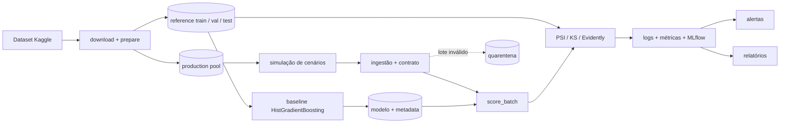

# Arquitetura CreditWatch

O comando `make demo-smoke` valida os seis estágios e o formato de log sem depender dos módulos dos demais responsáveis. `make demo` conecta os componentes pelas assinaturas de `src/creditwatch/interfaces.py`; a CLI informa as interfaces de equipe que ainda não estiverem disponíveis.

Os splits são estratificados, gerados com seed fixa e separados por `customer_id`. `production_pool` não participa do treino. Dados brutos e processados permanecem fora do Git.
